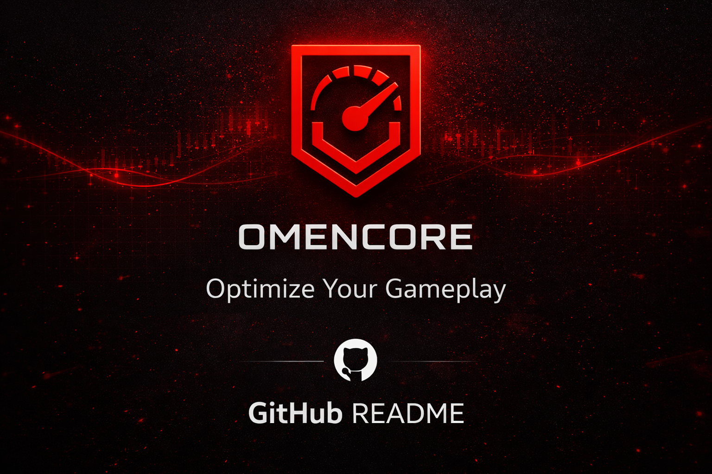
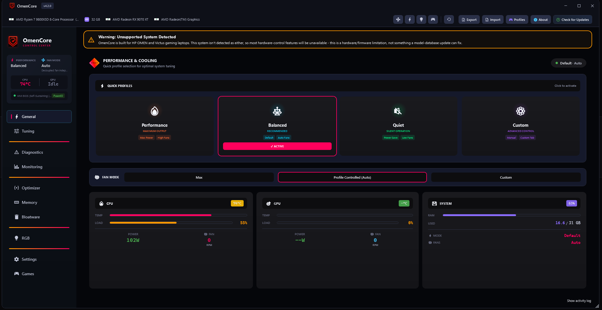
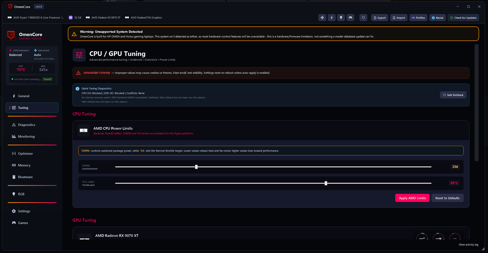

<div align="center">



# OmenCore

### Lightweight local control for HP OMEN and Victus gaming laptops

[](https://omencore.info)
[](docs/CHANGELOG_v5.0.0.md)
[](LICENSE)
[](https://dotnet.microsoft.com/download/dotnet/8.0)
[](https://discord.gg/9WhJdabGk8)

**[Download](https://github.com/theantipopau/omencore/releases/latest)** ·
**[What's new in 5.0.0](docs/CHANGELOG_v5.0.0.md)** ·
**[Install guide](INSTALL.md)** ·
**[Discord](https://discord.gg/9WhJdabGk8)**

</div>

---

OmenCore is a free, open-source replacement for the parts of OMEN Gaming Hub people actually use: fan control, performance modes, GPU Power Boost, keyboard lighting, monitoring, an in-game overlay and cleanup of HP background software.

No account, no ads, no cloud telemetry ([details](docs/TELEMETRY.md)), and OMEN Gaming Hub does not need to be installed. It talks to the laptop directly through HP's WMI BIOS interface, the embedded controller (via PawnIO) and, on Linux, `hp-wmi` and sysfs.



<details>
<summary>More screenshots</summary>



</details>

## What's new in 5.0.0

Released 2026-11-13. Update from inside the app (the update button in the header, or F5); settings carry over.

> **Upgrading from 4.x and the installer seems stuck with the old version open?** Close the old OmenCore completely (tray icon → Exit) and the installer carries on. Uninstalling and then installing 5.0.0 also works; settings are kept. Fixed for the next release ([5.0.1 notes](docs/CHANGELOG_v5.0.1.md)).

- **Modes remember the whole machine.** A performance mode can carry a fan preset or custom curve, GPU Power Boost level, refresh rate, lighting profile and charge limit, not only power limits. Game profiles that use a mode get all of it. Your 4.x modes load unchanged.
- **Every greyed-out control says why**: the model database, the firmware, a safety rule or runtime detection. The same reason goes into the diagnostics export.
- **Faster start, lower memory.** CPU detection no longer waits on WMI (about 2 s saved on a cold boot), and idle memory is around 100 MB. CI enforces both budgets.
- **Interface refresh.** The window follows the active mode's colour, zooms, follows Windows high-contrast themes, has screen-reader names on the navigation, and the shell is translated into Russian and Turkish.
- **Safer updates.** The updater checks each download against the release's `SHA256SUMS` file, and every release carries GitHub build provenance.
- **Safer uninstall and upgrade.** The installer hands the fans back to the BIOS, so a fan left at Max no longer stays pinned.
- **Settings migrate.** A 4.x `config.json` is upgraded, and the original is kept as `config.json.schema0.bak`.

**Not in 5.0.0, planned for 5.1:** signed binaries (Windows SmartScreen still shows "unknown publisher"), a UI that does not run as administrator, and translations for the remaining pages.

Full notes: [docs/CHANGELOG_v5.0.0.md](docs/CHANGELOG_v5.0.0.md). Hardware-facing changes are marked *pending confirmation* until an owner reports them working on a real board.

## Features

| Area | What you get |
|---|---|
| **Fans** | Auto, Max, preset modes and custom temperature curves where the board safely supports them; one-click hand-back to the BIOS; guided fan verification |
| **Performance** | Quiet, Balanced, Performance and custom modes that also carry fans, GPU boost, refresh rate, lighting and charge limit; per-game profiles that switch automatically |
| **GPU** | GPU Power Boost and MUX switching on supported firmware; NVIDIA and AMD telemetry; opt-in NVIDIA laptop power unlock |
| **CPU tuning** | Intel undervolt and TCC offset, AMD power limits and Curve Optimizer where the model and BIOS allow them, with crash-safe test-apply |
| **Lighting** | OMEN four-zone and per-key keyboards, brightness and effects; Corsair, Logitech, Razer and OpenRGB devices |
| **Monitoring** | CPU and GPU temperature, load, power and fan speed, battery and memory; click-through overlay with RTSS FPS; live tray icon |
| **Battery** | Battery Care charge limit; automatic AC and battery profiles |
| **Cleanup** | Guided OMEN Gaming Hub removal, HP bloatware scanner, memory optimiser |
| **Diagnostics** | One-click export with model identity, capability reasons, fan history and firmware fan table, for fast and accurate bug reports |
| **Linux** | Command-line tool and desktop GUI over `hp-wmi`, `ec_sys` and hwmon |

## Supported hardware

OmenCore is built for HP OMEN and Victus laptops. Support is decided per board (the `ProductId` in Diagnostics), and anything not confirmed on a real board starts with conservative defaults.

| Hardware | Support |
|---|---|
| OMEN 15 / 16 / 17 laptops | Primary target: fans, modes, monitoring, lighting and power features, by model |
| Victus laptops | Fans, modes, monitoring and backlight; GPU power and undervolt often unavailable |
| OMEN MAX 16 / 17, OMEN Transcend | Supported; some lighting and power paths still need owner confirmation |
| OMEN desktops | Monitoring, modes and cleanup; fan writes are disabled for safety |
| Other HP and non-HP machines | Monitoring only; control features are not targeted |

If your board is not recognised, see [Requesting support for your model](#requesting-support-for-your-model).

## Download and install

Get the files from the [latest release](https://github.com/theantipopau/omencore/releases/latest).

| File | For |
|---|---|
| `OmenCoreSetup-5.0.0.exe` | Most Windows users. Installs the app and, optionally, the PawnIO driver. |
| `OmenCore-5.0.0-win-x64.zip` | Portable Windows use. Extract and run `OmenCore.exe` as administrator. |
| `OmenCore-5.0.0-linux-x64.zip` | Linux command-line tool and GUI, self-contained. |

### Windows

1. Download `OmenCoreSetup-5.0.0.exe`.
2. Run it. Windows may warn about an unknown publisher because the installer is not yet signed: choose **More info**, then **Run anyway**. You can verify the file first (see below).
3. Keep **PawnIO** selected unless you only want monitoring and the WMI features.
4. Start OmenCore from the Start menu.

Needs Windows 10 (19041 or later) or Windows 11, x64. The .NET 8 runtime is included. The app runs as administrator because WMI BIOS and embedded-controller access require it.

### Linux

```bash
VERSION=5.0.0
wget "https://github.com/theantipopau/omencore/releases/download/v${VERSION}/OmenCore-${VERSION}-linux-x64.zip"
unzip "OmenCore-${VERSION}-linux-x64.zip" -d OmenCore-linux-x64
cd OmenCore-linux-x64
chmod +x omencore-cli omencore-gui

sudo ./omencore-cli status
./omencore-gui
```

Needs x64 Linux with `hp-wmi`, `ec_sys` (`write_support=1`) or a compatible hwmon interface. What works varies a lot by board and kernel. More in [docs/LINUX_INSTALL_GUIDE.md](docs/LINUX_INSTALL_GUIDE.md).

### Verify a download

Every release publishes a `SHA256SUMS` file and a `.sha256` file next to each download, computed by the release workflow from the exact files it attached. Each file also carries GitHub build provenance, which proves it was built by this repository's workflow from the tagged commit:

```bash
gh attestation verify OmenCoreSetup-5.0.0.exe --repo theantipopau/omencore
```

Antivirus warnings are covered in [docs/ANTIVIRUS_FAQ.md](docs/ANTIVIRUS_FAQ.md) and [docs/DEFENDER_FALSE_POSITIVE.md](docs/DEFENDER_FALSE_POSITIVE.md).

## Troubleshooting

| Problem | What to try |
|---|---|
| A control is greyed out | Open Advanced, or export diagnostics (`capability-reasons.txt`): it says why, and whether the reason is the model, the firmware or a safety rule |
| Fans have no effect | Diagnostics → Guided Fan Verification, then export diagnostics |
| Fans stay loud | Pick any fan mode, or **Restore OEM Auto**, to hand control back to the BIOS |
| PawnIO unavailable | Re-run the installer with PawnIO selected, reboot, and run OmenCore as administrator |
| Lighting does not apply or resets | Close other HP lighting tools; export diagnostics so the keyboard backend is on record |
| Battery Care fails | Connect AC power and try again; export diagnostics with your BIOS version |
| Overlay hidden in a game | Use borderless or windowed fullscreen; Windows cannot draw overlays over exclusive fullscreen |
| Linux: permission denied | Run the command-line tool with `sudo` |

Windows logs are in `%LOCALAPPDATA%\OmenCore\`. On Linux, `./qa/collect-linux-triage.sh` or `sudo ./omencore-cli diagnose --report` collects a bundle.

## Reporting a problem

Open **Diagnostics → Export** and attach the zip to a [GitHub issue](https://github.com/theantipopau/omencore/issues) or post it on [Discord](https://discord.gg/9WhJdabGk8). Say what you did, what you expected and what happened. The export contains your model identity, capability reasons, fan history and logs, which is almost always enough to find the cause.

### Requesting support for your model

If Diagnostics shows `Unknown <Family> Model` or "Family fallback / Low confidence", your laptop is running on generic defaults. To get a proper entry:

1. Copy the **Model Identity Summary** from Diagnostics in full.
2. Note which features work and which do not (fans, modes, Battery Care, lighting).
3. Open a GitHub issue with both, plus a diagnostics export.

New entries start conservative and are widened as owners confirm each feature on real hardware.

## Building from source

```powershell
git clone https://github.com/theantipopau/omencore.git
cd omencore
dotnet build OmenCore.sln -c Release
dotnet test OmenCore.sln
```

Release artifacts: `pwsh ./build-installer.ps1 -SingleFile` (Windows installer and portable zip, needs Inno Setup) and `pwsh ./build-linux-package.ps1` (Linux zip). Both write to `artifacts/` with a `.sha256` next to each file. The version comes from `VERSION.txt` only.

The test suite (2,100+ tests) checks the logic: model resolution, fan-curve and safety math, the diagnostics export, view-model state and regressions pinned to real reports. It cannot prove a particular board's firmware responds the way the code expects, which is why hardware-facing changes stay *pending confirmation* until an owner reports back.

## Contributing

The most useful contributions are diagnostic exports from real boards, confirmation that a pending fix works on your laptop, Linux sysfs snapshots, translations and focused bug fixes. People whose code, research and testing are in the project are credited in [CONTRIBUTORS.md](CONTRIBUTORS.md); third-party code is credited in [THIRD-PARTY-NOTICES.md](THIRD-PARTY-NOTICES.md).

## Release history

| Version | Date | Notes |
|---|---|---|
| **5.0.0** | 2026-11-13 | [Changelog](docs/CHANGELOG_v5.0.0.md): modes that carry the whole machine, capability reasons, startup and memory budgets, interface refresh, checksum-verified updates |
| 4.5.1 | 2026-11-10 | [Changelog](docs/CHANGELOG_v4.5.1.md): 8E10 backlight regression, V0 fan-mode bytes, 8BCD keyboard layout, new boards |
| 4.5.0 | 2026-10-24 | [Changelog](docs/CHANGELOG_v4.5.0.md) |
| 4.4.5 | 2026-10-11 | [Changelog](docs/CHANGELOG_v4.4.5.md) |
| 4.4.1 | 2026-10-03 | [Changelog](docs/CHANGELOG_v4.4.1.md) |
| 4.4.0 | 2026-09-24 | [Changelog](docs/CHANGELOG_v4.4.0.md) |

Older release notes, roadmaps and investigation records are in [docs/](docs/).

## Safety and disclaimer

OmenCore is provided as-is. Fan control, embedded-controller writes, undervolting, GPU power changes and MUX switching can affect stability and hardware behaviour. Read the warnings in the app, and leave experimental options off unless you know how to recover.

OmenCore is an independent project and is not made by or endorsed by HP.

## Links

- Website: https://omencore.info
- Releases: https://github.com/theantipopau/omencore/releases/latest
- Issues: https://github.com/theantipopau/omencore/issues
- Discord: https://discord.gg/9WhJdabGk8
- Donate: https://www.paypal.com/donate/?business=XH8CKYF8T7EBU

## License

MIT. See [LICENSE](LICENSE). Third-party components (LibreHardwareMonitor, Hardcodet.NotifyIcon.Wpf, PawnIO and vendor RGB SDK files where bundled) are listed in [THIRD-PARTY-NOTICES.md](THIRD-PARTY-NOTICES.md).
