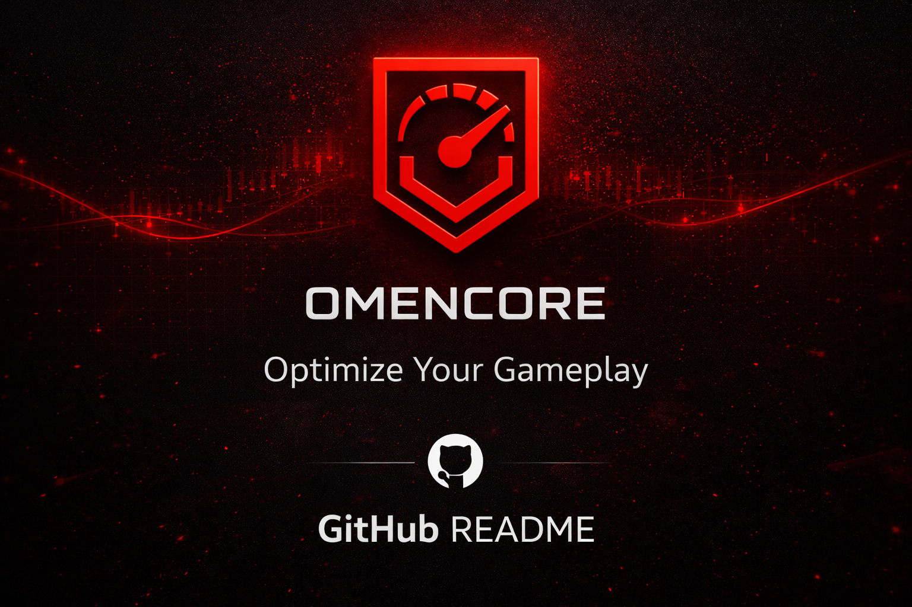
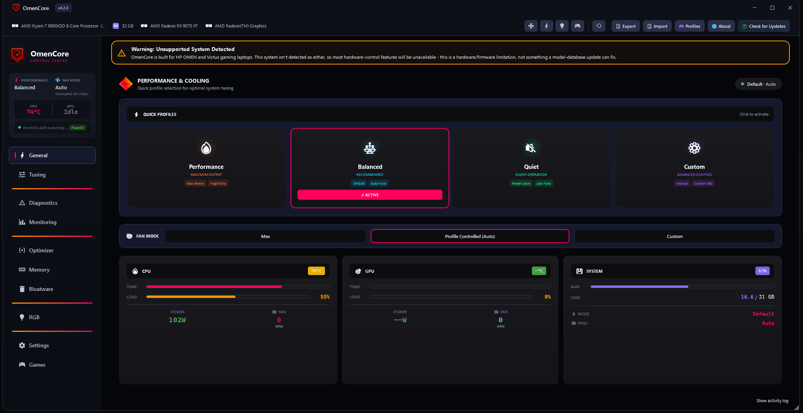
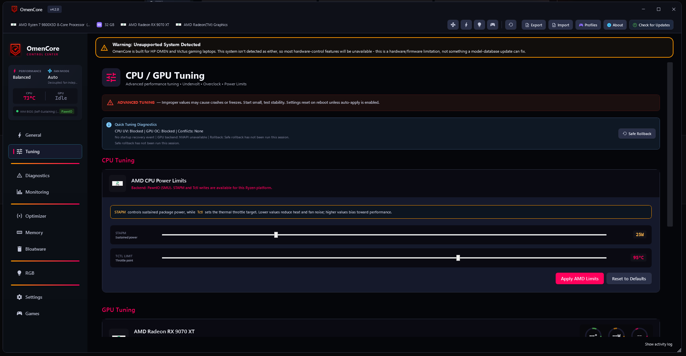

<div align="center">



# OmenCore

### Lightweight local control for HP OMEN and Victus gaming laptops

[](https://omencore.info)
[](docs/CHANGELOG_v4.4.5.md)
[](LICENSE)
[](https://dotnet.microsoft.com/download/dotnet/8.0)
[](https://discord.gg/9WhJdabGk8)

</div>

---

OmenCore is an independent control center for HP OMEN and Victus systems. It focuses on the local workflows people actually use in OMEN Gaming Hub: fan control, performance profiles, telemetry, keyboard lighting, OSD, power tools, diagnostics, and safe cleanup of HP background software.

It runs without ads, account prompts, cloud telemetry, or OMEN Gaming Hub. Hardware access is handled through local WMI BIOS, EC, PawnIO, Linux sysfs, and platform backends when the device exposes them.



<details>
<summary>More screenshots (CPU/GPU Tuning)</summary>



</details>

## At A Glance

| Area | What OmenCore Provides |
|---|---|
| Fan and thermal control | WMI BIOS fan profiles, Max/Auto handoff, custom curves where the model safely supports them |
| Performance profiles | Quiet, Balanced, Performance, custom profile routing, power-policy diagnostics |
| GPU controls | MUX switching and GPU Power Boost on supported OMEN firmware |
| RGB | OMEN keyboard zone lighting plus external RGB provider integration where supported |
| Monitoring | CPU/GPU temperature, load, fan telemetry, health state, history, and core-control diagnostics |
| OSD and tray | Click-through overlay, hotkey toasts, quick popup, live tray status |
| Cleanup | OMEN Gaming Hub and HP bloatware detection/removal helpers |
| Linux | CLI and Avalonia GUI for supported hp-wmi/ec_sys/sysfs paths |

## Why People Use It

| OmenCore Principle | Result |
|---|---|
| Local first | No sign-in, no ads, no outbound telemetry ([details](docs/TELEMETRY.md)) |
| Safety gated | Unsupported EC/fan/RGB paths stay hidden or diagnostic-only |
| Field driven | Model quirks are tracked by ProductId, BIOS behavior, and logs |
| Fast startup | Hardware polling and heavy providers are deferred where possible |
| Honest capability UI | Requested, confirmed, degraded, and unsupported states are separated |

## Current Release

**Version:** 4.5.0<br>
**Released:** 2026-10-24<br>
**Status:** Test-verified (1980/1980 app tests and 71/71 Linux tests, 0 build warnings). A field-report and model-database release: board entries for 8BC2, 88D1, 8F21, 8F5C and an exact 88ED row, the one-zone keyboard colour layout for 8BD4/8BC2, hotkeys that report when another app holds them, optional Max fan auto-return, AMD power limits that now save when the Tctl write is refused, and square window corners when maximised. Much of it is marked pending until a reporter confirms it on real hardware.<br>
**Upgrade note:** update from inside the app (the update button in the header, or F5). Settings are kept.<br>
**Release notes:** [docs/CHANGELOG_v4.5.0.md](docs/CHANGELOG_v4.5.0.md)<br>
**Roadmap:** [docs/ROADMAP_v4.5.0.md](docs/ROADMAP_v4.5.0.md)

SHA256 hashes are computed by the release workflow from the exact files attached to the release and are published in the [release notes](https://github.com/theantipopau/omencore/releases/tag/v4.5.0).

Full detail on every item, and what still needs field confirmation, is in [docs/CHANGELOG_v4.5.0.md](docs/CHANGELOG_v4.5.0.md).

### v4.4.5 Highlights (previous release)

- **Added (opt-in, off by default):** NVIDIA laptop GPU power unlock in Tuning (Resolve VBIOS, Apply MAX, restart, Apply CURRENT), from timmyy123's `nvidia-power-control` and bobshmo's OmenCore-Prophecy, used with their permission. Backs up the registry, reads every write back, rolls back on a mismatch, and on Victus laptops prepares HP performance mode and the fan engine first. Run by its authors, not yet through OmenCore.
- **Added (opt-in, experimental):** HP's factory Performance-mode fan curve for the OMEN MAX 16 `8D87`, where firmware Auto parks the fans at ~3,400/3,600 RPM with the CPU at 92-99 C ([#189](https://github.com/theantipopau/omencore/issues/189), research by mbilykov). Runs only in Performance mode with fans on Auto and hands the fans back on any other mode, on diagnostics, on thermal protection and after three failed writes.
- **Added:** a reversible switch for HP's analytics and diagnostics services (Advanced); the OMEN key can run every action the app supports, including your own program or script, and applies changes immediately; a read-only GPU power policy line in Tuning and the diagnostics export; a memory breakdown in the diagnostics export.
- **Added:** an RGB payload probe (Diagnostics > Keyboard) that tries five candidate single-zone colour tables, for the 8BD4 keyboard that still ignores colour ([#212](https://github.com/theantipopau/omencore/issues/212)).
- **Fixed:** a saved Fan Max no longer comes back at startup or after sleep unless you opt in; a rise of 8 C or more is answered at once instead of 5-10 s late ([#222](https://github.com/theantipopau/omencore/issues/222)); a maximised window no longer covers an auto-hidden taskbar; the RTSS conflict warning is logged once instead of every minute.
- **Performance:** the GPU load fallback reads one counter set instead of about 290 (about 144 ms per poll down to about 2 ms in a benchmark).
- **Linux:** the daemon and `omencore-cli fan` commands share one fan-writer lock; an optional keyboard backlight suspend hook ([`scripts/linux/omencore-kbd-suspend.sh`](scripts/linux/omencore-kbd-suspend.sh)).
- **Model database:** new unverified entries for `8E9F`, `8E9A`, `8EEC` and `8A13`; `8E9F` and `8E9A` keyboards routed to the per-key backends as a guess.

Full detail on every item, and what still needs field confirmation, in [docs/CHANGELOG_v4.4.5.md](docs/CHANGELOG_v4.4.5.md). Third-party code is credited in [THIRD-PARTY-NOTICES.md](THIRD-PARTY-NOTICES.md) and contributors in [CONTRIBUTORS.md](CONTRIBUTORS.md).

### v4.4.1 Highlights (previous release)

- **Fixed:** Guided Fan Verification and Fan Cleaning could leave the fans at full speed afterwards ([#198](https://github.com/theantipopau/omencore/issues/198), [#220](https://github.com/theantipopau/omencore/issues/220)). Both now release the firmware's Max flag with the controller's own exit sequence, and the controller is told about direct fan writes so "restore auto" hands the fans back (PR #216).
- **Fixed:** boards that report two fans were treated as having one, because the model database overwrote the firmware's count (`8C30`, `88F8`, `8C2D`). A firmware count that was actually read now beats an unverified entry that says fewer.
- **Fixed:** the 100% fan-test step failed boards whose firmware accepts Max but stops a little short of the table ceiling (`8E35`, `88F7`, `88EE`). A stable result at 80% or more of the ceiling, after Max and a direct write have both been tried, now passes.
- **Fixed:** the watchdog failsafe now releases only after temperatures hold at 65 °C or below for 15 seconds, and re-applies itself every 15 seconds while active.
- **Fixed (tuning):** a false "Degraded" undervolt state on fresh installs (the default no longer pre-fills −90/−60 mV); an untested GPU overclock or CPU undervolt is reverted if OmenCore closes during its Test Apply window, and written back to defaults on the next launch if it crashed mid-test.
- **Fixed (RGB and panels):** backlight-only keyboards are no longer offered colour controls ([#217](https://github.com/theantipopau/omencore/issues/217)); Windows Dynamic Lighting is detected on four-zone keyboards; the GPU-mode Apply button shows why it is disabled instead of doing nothing ([#215](https://github.com/theantipopau/omencore/issues/215)); GPU Power Boost is hidden on Victus boards that cannot use it; the startup performance-mode label no longer disagrees with the dashboard ([#199](https://github.com/theantipopau/omencore/issues/199)).
- **Fixed:** the RAM optimizer's working-set trim sent the wrong Windows command and trimmed nothing; two cleans could run back to back. The system cleaner now uses the vendor's own silent uninstall command.
- **Fixed (Linux):** a dead ACPI temperature zone could outrank the real CPU sensor, so a custom fan curve never ramped ([#214](https://github.com/theantipopau/omencore/issues/214)); CPU sensors are now ranked and `thermal.cpu_sensor` forces one by driver name. Support for the DKMS `hp-wmi` four-zone keyboard nodes, including the brightness gate that leaves a keyboard dark after a successful colour write.
- **Added:** if OmenCore exits unexpectedly, the next launch logs one line with the process id, last-alive time and any Windows crash record for it ([#211](https://github.com/theantipopau/omencore/issues/211)); Ctrl+1…9 jumps between pages; Guided Fan Verification gains an RGB check that restores your saved colours (PR #216).
- **Added (experimental):** uniform colour for the Primax per-key keyboards on 2021-2024 OMEN 16/17, through the keyboard's own USB controller. Hardware confirmation pending.
- **Model database:** new exact entries for `8BBE`, `88F8`, `88F7`, `8C2D` and `878A`; keyboard entries for `8BA9`, `88F7` and `8DD0`; `8DD0` and `8C30` corrected to two fans; `8E35` Performance mode confirmed at the firmware by PM-table readback ([#195](https://github.com/theantipopau/omencore/issues/195)).
- **Candidate, unconfirmed:** the zone-colour RGB fix for single-zone keyboards ([#212](https://github.com/theantipopau/omencore/issues/212)).

Full detail on every item in [docs/CHANGELOG_v4.4.1.md](docs/CHANGELOG_v4.4.1.md). Contributors are credited in [CONTRIBUTORS.md](CONTRIBUTORS.md).

### v4.4.0 Highlights (previous release)

- **Fixed (4.3.1 regression):** fan control was switched off on boards with older (V0) firmware, where HP's "software fan control supported" bit is simply never filled in — Custom Fan Curve, linked fan profiles and Max stopped working, and Guided Fan Verification reported "Backend: None" ([#203](https://github.com/theantipopau/omencore/issues/203), [#202](https://github.com/theantipopau/omencore/issues/202), [#207](https://github.com/theantipopau/omencore/issues/207), [#201](https://github.com/theantipopau/omencore/issues/201), [#208](https://github.com/theantipopau/omencore/issues/208)). The bit is now logged, never acted on.
- **Fixed (4.3.1 regression):** a 2-minute background polling interval tripped the hardware watchdog's 90-second "monitoring frozen" failsafe, forcing fans to 90% about every two minutes while the window was hidden, and cancelling a held Max fan mode on boards where fan control worked ([#191](https://github.com/theantipopau/omencore/issues/191), [#199](https://github.com/theantipopau/omencore/issues/199)).
- **Fixed (4.3.1 regression):** opening the window or the OSD waited out the monitor's current sleep, so numbers took minutes to appear and fan speed showed 0.
- **Fixed:** a frozen ACPI thermal zone could keep winning CPU-temperature authority back, making temperatures swing wildly and fans misbehave ([#198](https://github.com/theantipopau/omencore/issues/198)).
- **Fixed:** in-app updates never worked on release builds — installed copies were detected as portable and downloaded the zip. Fixed for updates from 4.4.0 onward; from 4.3.1, download the installer manually.
- **Fixed:** plugging in some USB drives crashed the whole hardware worker (a bug in LibreHardwareMonitor's disk backend); disk monitoring is now off ([#199](https://github.com/theantipopau/omencore/issues/199)).
- **Fixed:** on installed builds the background hardware worker often failed to start at all, silently falling back to slower in-app monitoring.
- **Fixed:** game-launch detection made Windows' WMI service use about 14% of a CPU core the whole time OmenCore was open; now about 2.6%.
- **Fixed:** Max fan mode on firmware that accepts the command but ignores it now falls back to driving the fans to their top level; quitting right after switching to Max no longer leaves the fans at maximum.
- **Fixed:** the Ctrl+Shift+F fan-mode notification always showed the previous mode; game exit now runs the full Balanced restore on the UI thread ([#206](https://github.com/theantipopau/omencore/issues/206)); tray refresh-rate shortcuts now change the laptop screen instead of an external monitor when docked.
- **Added (community, PR #176):** OMEN MAX 16 (`8D87`) per-key keyboard brightness that actually works, a staged Fn+1/Fn+2 effect cycle, and a Windows Dynamic Lighting notice; AMD power limits written as a set of four and read back from the SMU; the iGPU undervolt slider hidden on CPUs that refuse every write.
- **Added (community, PR #196):** correct System SKU in diagnostics, fan RPM marked as measured or estimated, and a performance-mode trace that says whether firmware policy was actually applied.
- **Model database:** new entries for `8CC0`, `8DD0` and `88ED`; `8E35` Performance mode now uses the WMI policy fallback after a controlled 0.0 W test showed it did nothing ([#195](https://github.com/theantipopau/omencore/issues/195)); Victus 15 `8BB1` no longer claims to be a 2022 model ([#202](https://github.com/theantipopau/omencore/issues/202)).
- **Not in this release:** the OMEN MAX 16 (`8D87`) GPU power unlock is written but switched off — pre-release review found its EC write path unproven on real hardware.

Full detail on every item in [docs/CHANGELOG_v4.4.0.md](docs/CHANGELOG_v4.4.0.md).

### v4.3.1 Highlights (earlier release)

- **Fixed (data loss):** saved settings — a custom fan curve, a custom AMD CPU Power Limit — could silently revert after doing something unrelated elsewhere in the app, reported independently by two users on two different boards ([#191](https://github.com/theantipopau/omencore/issues/191)). Root cause: `ConfigurationService` handed out a brand-new, detached config object on every load instead of a shared instance, so whichever of several stale in-memory copies saved last silently overwrote every other part's changes. Fixed by making every load converge on one shared, always-current object.
- **Fixed:** the auto-updater's SHA256 extraction regex never matched the release-notes hash table's actual format, so update checks always reported "missing SHA256" and fell back to manual-download-only regardless of content ([#192](https://github.com/theantipopau/omencore/issues/192)).
- **Fixed (release process):** the hash mismatch above had a second half — past release notes carried hashes hand-copied from a separate local build, which don't match what CI independently rebuilds and publishes ([#194](https://github.com/theantipopau/omencore/issues/194)). `build-installer.ps1` now generates a real SHA256 for both Windows artifacts, and the release workflow publishes hashes read back from the exact files it just built — this release's own hash table above is proof it works.
- **Fixed:** OMEN key WMI events were being unconditionally discarded whenever the keyboard hook was active, on the assumption the hook would also catch the key — on boards where the physical key produces no keyboard-observable code at all, that threw away the only real signal ([#193](https://github.com/theantipopau/omencore/issues/193)).
- **Fixed:** the entire Settings → Notifications section (master switch, Game/Mode-change notifications, Temperature warnings) saved correctly but was never applied to the live notification service, at startup or after being changed.
- **Fixed (Ohman cross-check) — reverted in 4.4.0, see the [erratum](docs/CHANGELOG_v4.3.1.md):** unverified boards no longer assume software fan control works when HP's own firmware-authored `SystemDesignData` explicitly says it doesn't — narrowly scoped to never second-guess a hand-verified board and never grant a capability a template didn't already claim.
- **Fixed (Ohman cross-check) — reduced to 30 s in 4.4.0, see the [erratum](docs/CHANGELOG_v4.3.1.md):** GPU telemetry now backs off to a 2-minute cadence once confirmed idle (3 consecutive low-utilization/low-power samples), since polling a discrete GPU at all can keep it out of its deepest idle power state.
- **Added:** four-zone keyboard lighting gets an actual drawn keyboard to click zones on, instead of four labeled rectangles — matching the per-key editor's existing visual approach.
- **Added:** Dashboard's CPU/GPU temperature numbers are bigger (32px → 52px), and the Razer Devices card uses Razer's real logo instead of a placeholder.
- **Model database:** board `8BAD` was displaying as "OMEN 15" on a real 17" laptop, fixed; board `8C9C` gets a real, field-confirmed database entry (two Guided Fan Verification runs, 84-88/100) instead of generic family fallback; board `8E35`'s notes corrected to flag a CPU-identity conflict between two independent reports instead of asserting either one.
- **Architecture:** `MainViewModel` (6,275 → 4,665 lines, -26%) and `SystemControlViewModel` (5,610 → 5,290 lines) both decomposed further — `UpdateViewModel`, `GpuClampViewModel`, and `SystemMaintenanceViewModel` extracted, plus dead-code deletion. Pure structural refactors, no fan/EC/thermal/undervolt/GPU-OC write path touched.

Full detail on every item in [docs/CHANGELOG_v4.3.1.md](docs/CHANGELOG_v4.3.1.md).

### v4.3.0 Highlights (previous release)

- **Fixed (safety):** the Quiet Safety Monitor's "power mode retained" guarantee during a Max-fan safety override was silently undone by Fan/Performance linking, cascading into an unwanted performance-mode switch on a transient CPU spike ([#181](https://github.com/theantipopau/omencore/issues/181)). Fixed with an explicit suppress-linked-sync flag threaded through the one caller that needs it; every user-initiated Max Fan trigger is unaffected.
- **Fixed (Linux, high-severity safety):** switching Max → Auto under load could leave both fans at 0 RPM indefinitely on a board with degraded ACPI, ending in a real thermal shutdown ([#183](https://github.com/theantipopau/omencore/issues/183)). Now polls RPM after the write and falls back to the board's own confirmed-working Max path if both fans are still dead above a conservative safety bar.
- **Fixed (stability):** a recurring native `AccessViolationException` in the AMD ADL telemetry path on hybrid AMD+NVIDIA hardware — killed 3 of 4 full test runs before being traced and quarantined the same way the out-of-process hardware worker already protects itself.
- **Fixed:** Power Automation force-applied the configured AC/Battery preset on every startup regardless of whether the power source had actually changed, silently discarding a manual mid-session profile choice. Now compares against the last-confirmed power state and no-ops when nothing changed.
- **Fixed:** built-in "Night Mode"/"Work" RGB scenes shipped with a baked-in, un-opt-out-able daily schedule and zero UI to see or disable it — every install silently changed keyboard lighting at 10PM/9AM regardless of what the user had manually set, including explicitly off. The default schedule is removed; both scenes remain manually selectable.
- **Fixed:** model-capability fallback logic (used for any board without an exact database entry) defaulted to optimistic instead of conservative, claiming GPU Power Boost, independent fan curves, undervolt, and more as "Supported" on hardware never confirmed to have them ([#182](https://github.com/theantipopau/omencore/issues/182)). Both fallback paths now assume nothing beyond WMI fan control and performance profiles by default.
- **Fixed (Linux):** GPU telemetry never queried NVML, so a real, working NVIDIA GPU read as 0°C/unavailable in both the CLI and GUI ([#186](https://github.com/theantipopau/omencore/issues/186)) — fixed in three independent places that all had the same gap, plus GPU name/power/utilization now shown.
- **Fixed (Linux):** the OMEN key WMI watcher could register cleanly and then never receive a single event on some boards ([#187](https://github.com/theantipopau/omencore/issues/187)) — traced to a server-side WQL filter silently never matching on affected `hpqBEvnt` schemas; the existing client-side validation already made a broader subscription safe.
- **Fixed:** `88EC` (HP Victus 16-e0xxx) performance-mode switches did nothing at all — missing the same one-flag WMI-fallback fix already shipped for four sibling boards ([#128](https://github.com/theantipopau/omencore/issues/128) follow-up).
- **Fixed:** a Corsair DPI-editor write could show a confirmation dialog and update saved state for a write that silently never reached the mouse, plus a fabricated 100% battery reading; GPU Power Boost's wattage badge was hardcoded regardless of level, now level-aware with a firmware-ceiling caveat.
- **Fixed:** capability classifier's "Full Control" reason text could name the wrong control mechanism on Linux ([#127](https://github.com/theantipopau/omencore/issues/127), [#126](https://github.com/theantipopau/omencore/issues/126)) — diagnostic-text only, no classification change.
- **Added:** four more automation trigger types promoted to the Settings UI (Temperature, Idle, Process, WiFi SSID — two of which had real bugs fixed as part of promoting them) plus a new Lid-close trigger, completing all seven backend trigger types shipped.
- **Added:** `OmenCore.Core` — the hardware/service layer (194 files) extracted out of the WPF application into its own class library, unblocking a Windows CLI, a future local HTTP/named-pipe API, and headless operation.
- **Added:** a Windows CLI (`omencore-cli`) — `status`, `fan`, `performance`, `keyboard`, `monitor`, `config`, and foreground `daemon` commands built directly on `OmenCore.Core`, no duplicated hardware logic.
- **Model database:** corrected fallback logic plus new/fixed exact entries for boards `8E10`, `8D26`, `8E5E`, `8603`, `8BA9`, and updated notes for `88D2` — all from real field reports, one (`8E10`'s `MaxFanLevel`) a self-caught correction before it shipped, documented in full in the roadmap.
- **GitHub backlog:** audited older open issues against the current codebase and closed 10 that already had an unconditional fix shipped in an earlier cycle but were never replied-to or closed; six more given evidence-based replies without a code change.

Full detail on every item in [docs/CHANGELOG_v4.3.0.md](docs/CHANGELOG_v4.3.0.md).

### v4.2.0 Highlights (previous release)

- **Fixed:** CPU temperature could report a chassis sensor instead of the CPU on boards with multiple ACPI thermal zones — affects fan control, not just the display. Selection is now a pure, unit-tested function re-evaluated every poll rather than latched once per session.
- **Added:** the CPU temperature source (WMI BIOS / ACPI / LibreHardwareMonitor fallback) is now visible as a Dashboard tooltip and in the diagnostics export, plus a new Diagnostics-tab card comparing all three sources side by side on demand.
- **Changed:** navigation moved from a horizontal, scroll-out-of-view tab strip to a vertical rail with visually grouped sections — redesigned three more times after real-hardware feedback: merging the rail into the sidebar as one panel, moving Quick Actions out to keep the tab list's vertical space, adding colored (orange-to-red) group separators, and auto-fit scaling so the tab list shrinks to fit a short window instead of just scrolling.
- **Fixed:** AMD CPU undervolt status text claimed "readback matches requested" when the AMD SMU path has no independent hardware register to read back from — it was comparing the app's own last-written value to itself. Now says so explicitly.
- **Fixed:** two RGB detection false positives, both found via real-hardware field testing — a false "OMEN Keyboard" badge shown on a system with no HP hardware at all (a keyboard-model-detection exception handler was defaulting to a real OMEN config instead of "no config"), and iCUE not detected despite running (an exact-process-name check that breaks every time Corsair renames the iCUE executable across major versions).
- **Fixed:** the Games tab's virtualization was silently doing nothing — a `WrapPanel` override defeated the `VirtualizingStackPanel` settings already declared next to it — and the per-game layout was reflowed into a more scannable single-line row.
- **Improved:** the Tuning tab's 16 buttons (CPU undervolt, power limits, thermal offset, GPU overclock) went from zero accessibility labels and 4 tooltips to full labeling and risk-aware tooltips everywhere, on the page where a mis-click has the most real consequence.
- **Added:** fan curve share codes — copy the current curve to the clipboard as a one-line code, or paste one in to import, for sharing in Discord/GitHub where a file attachment is awkward.
- **Added:** startup and tab-switch timing measured on every run, a reduce-motion preference, and a background-thread timer coordinator. The reduce-motion gate now has its first real consumer: a 160ms opacity fade on tab switches, skipped entirely when reduce-motion is on.
- **Fixed:** the title bar's minimize/maximize/close buttons — first a literal `[ ]` where the maximize icon should be, then (after a font-glyph fix that tofu'd on a real machine) replaced entirely with drawn vector icons that don't depend on a system font being present. Also fixed the buttons sitting inset with rounded corners instead of flush, square, and full-height like native Windows chrome.
- **Improved:** the system tray right-click menu — every submenu item was showing two arrows (a typed "▶" plus the menu's own drawn arrow); removed the redundant one and standardized on a single "Label: value" convention throughout.
- **Linux:** added sysfs support for the `omen-rgb-keyboard` DKMS driver, and fixed a fan-control warning that pointed users at a workaround that does nothing on boards where Max Fan is actually the working override.
- **Typography:** Roboto Condensed font declarations consolidated onto two shared resources across 105 XAML sites and 13 C# call sites (step 1, shipped, zero visual change). The actual font switch (step 2) was attempted, found genuinely non-deterministic in testing (glyph resolution differed between an isolated test run and the full suite), and reverted rather than shipped in a state observed failing part of the time.
- **Field reports:** five GitHub issues triaged (#177, #141, #163, #137, plus independent Discord confirmation the v4.1.7 Max-Fan-Latch fix is holding across a different board and reporter), and three community projects (OmenXHub, OmenCtl, `omen-rgb-keyboard`) reviewed for adaptable ideas — none of their code copied, since OmenCore is MIT and two of the three are GPLv3.

Full detail on every item in [docs/CHANGELOG_v4.2.0.md](docs/CHANGELOG_v4.2.0.md).

### v4.1.7 Highlights (previous release)

- **Fixed:** unconfirmed EC power-limit register writes (CPU PL1/PL2, GPU TGP) were attempted by default on any board that didn't explicitly opt out — a new `SupportsEcPowerLimits` capability flag now defaults this off everywhere until a model's addresses are field-confirmed. Safety-relevant; no board has ever had these addresses confirmed correct.
- **Fixed:** switching Performance Mode away from an active Max fan hold cleared OmenCore's internal state without releasing the real BIOS `SetFanMax` latch, leaving fans stuck at maximum speed until the app was fully closed (reported on board `8DCD`, HP Victus 15 fa2082wm) — `WmiFanController.SetPerformanceMode` now releases the latch before clearing its tracking flags.
- **Fixed:** GPU Power Boost's EC fallback claimed "Extended" applied when its register can't represent anything beyond "Maximum" — now refuses instead of falsely claiming success (GitHub #159's own session logs caught this firing on real hardware).
- **Fixed:** numbers throughout the UI rendered with a comma instead of a period on comma-decimal Windows locales — the app has no localization at all, so every display site was inheriting the OS locale by accident. Fixed once at app startup instead of touching 400+ call sites.
- **Fixed:** a real Spotify install was flagged as "Promotional app shortcut" bloatware, and board `8BCA` (shared by an Intel and an AMD OMEN 16 SKU) resolved to the wrong CPU vendor's profile, breaking keyboard control (GitHub #163).
- **Fixed:** the guided fan diagnostic displayed RPM readings one full test-step stale (60% consistently reading lower than 30%) — root-caused from a community member's own session logs to a display path reading a lagging telemetry cache instead of an already-fresh value sitting a few lines away. Pure display/scoring fix, no fan-control behavior touched.
- **Adopted:** sixteen community-contributed PRs/branches from `tempestnano`, all merged after individual file-by-file review — board `8D87` support (real fan range/tachometers, adapter awareness), an AMD SMU transport fix, per-key RGB for board `8D87` that also fixed reactive lighting being silently inert for every user on every board, **per-LED keyboard lighting extended to every supported board**, and an **experimental adapter power override** that drops GPU/CPU power clamps caused by an under-rated charger (off by default; single-board evidence so far, disclosed and merged on an explicit, informed decision after the review surfaced a real prior crash the fix itself resolves). Also: a fix for the app's own polling keeping a sleeping dGPU awake, and a real BSOD bug in the background hardware-monitoring process (its watchdog could run forever on PID reuse, polling the GPU on battery until Windows killed the machine). Full detail, including the safety framing on the adapter-override feature, in the changelog.
- **Improved:** three separate passes of UI-responsiveness fixes for a standing "laggy UI" complaint — chart controls doing a full teardown/rebuild on every telemetry tick, a dashboard pulse animation restarting continuously due to a broken equality check, a window-wide blur effect costing a full render pass on every resize/drag, and an in-game OSD overlay allocating a fresh brush every second while a game is running.
- **Fixed:** a brand-new AMD Family 26 CPU ("AMD Ryzen AI 7 350") was misidentified as ~2020 Renoir/Lucienne silicon — a fallback family check matched on model number alone with no family qualifier, and model numbers aren't unique across AMD generations (GitHub #171).
- **Added:** RAM Smart Clean in Quick Access (one-click safe memory clean from the tray popup), an opt-in "clean memory on launch" option per game profile, and a shared/default profile that can apply to a whole list of games instead of needing one profile per game (GitHub #173).
- **Fixed:** a WMI model-name-pattern fallback could hand an Intel board an AMD-only capability profile just because HP reused the same marketing name across different board revisions — the fallback now checks CPU vendor before matching (GitHub #172).
- **Improved:** a full code review of GPU Power Boost, GPU overclock/undervolt, and CPU overclock/undervolt (`docs/TUNING-SUBSYSTEMS-REVIEW.md`) found and fixed several places where the app reported something as applied when it wasn't or discarded a safety signal by defaulting it to a value indistinguishable from a real reading — all fixes here are reporting/consolidation only, no tuning behavior changed on the wire.
- **Fixed (Linux, severe):** the Linux GUI (`omencore-gui`) never actually controlled fans on boards that expose only a coarse `pwm_enable` toggle rather than a writable duty file — every fan request silently did nothing. Reported alongside a real overheat/shutdown incident on board `8BCA` (OMEN 16-xf0xxx). The CLI (`omencore-cli`) already had the correct fallback; the GUI never did, because the two Linux targets carry entirely separate hardware implementations. The fallback is now ported into the GUI (GitHub #174 + Discord report).
- **Improved (Linux):** keyboard RGB now tries three more sysfs backends (`hp-wmi/rgb_zones/zone00`-`zone03`, `hp-wmi/keyboardleds`, `hp_omen::kbd_backlight/zone_colors`) in both Linux targets, found by researching the projects raised in GitHub #175. The same pass fixed keyboard *brightness* control on boards exposing only the `hp_omen::` LED class name — both targets previously checked only `hp::`.
- **Adopted:** community PR [#150](https://github.com/theantipopau/omencore/pull/150) (`murilopontes`) — documented Linux fan boost via EC offset `0xEC` for board `84DB` (OMEN 15-dc0xxx), where stock `hp-wmi` `pwm1_enable=0` fails with `EINVAL`, with measured RPM data.

Full detail on every item in [docs/CHANGELOG_v4.1.7.md](docs/CHANGELOG_v4.1.7.md).

### v4.1.5 Highlights (previous release)

- **Fixed:** GPU Power Boost never worked on Victus 16-d1176TX (board `8A25`) — added the model-database entry this exact board was missing, with `SupportsGpuPowerBoost = true`.
- **Fixed:** locked fan-curve/direct-control tooltips said "unavailable for this model" with no explanation, which real users misread as related to the separate "unverified model" status — now explicitly states it's a hardware/firmware limitation.
- **Fixed:** `ApplyMaxCooling()` silently reported success even when the hardware write failed, including in the thermal-critical safety-override path — fans could stay unchanged during a real overheat event while the log and UI both claimed "Max cooling active."
- **Fixed:** Razer RGB effect setters (static/breathing/spectrum/wave/reactive/custom) reported success with no active Chroma SDK session — same silent-failure bug class as the Logitech fix in 4.1.0, found during a follow-up audit.
- **Fixed:** Corsair RGB write failures were indistinguishable from success across all three SDK backends (stub/iCUE/direct-HID) — a device write that silently failed was still counted and logged as applied.
- **Fixed:** the top-level "Unsupported or Unverified Gaming System" banner conflated two different states — a genuinely supported OMEN/Victus with an unconfirmed model got no banner at all despite the text claiming to cover it. Now two independently-gated banners.
- **Fixed:** `SettingsView.xaml` accessibility labeling, left at 53/156 controls in an earlier cycle, is now complete (156/156) — closes out the multi-session accessibility pass across all six views.

Full detail on every item in [docs/CHANGELOG_v4.1.5.md](docs/CHANGELOG_v4.1.5.md).

### v4.1.0 Highlights (previous minor)

- **Fixed:** the sidebar and General-tab main cards could show different temperatures at the same instant — the sidebar was subscribed directly to raw, unfiltered sensor data and bypassed the same spike-rejection/stabilization every other surface received.
- **Fixed:** "temperature appears frozen" was a false positive most of the time — the detector didn't account for HP WMI's whole-degree sensor quantization, so a machine sitting at real thermal equilibrium (steady load, steady temp) was flagged as a stuck sensor. One field session alone logged 48 false warnings.
- **Fixed:** fans re-asserting to Max in a loop for ~2.5 minutes after a thermal emergency on board `8A18` — the "still holding Max?" health check used a floor that was mathematically unreachable on this board's hardware.
- **Fixed:** the per-model GPU Power Boost capability flag was dead code on every Victus board — a blanket vendor-family deny (added for a real 2023 bug) short-circuited before the database flag was ever consulted, so a field-verified entry could never take effect.
- **Fixed:** `PowerAutomationService` (AC/Battery profile switching) never actually applied real CPU/GPU wattage on 57 of 59 boards in the database — it built a bare zero-watt object instead of routing through the existing, already-safe wattage-aware apply path. This affected every user who enabled the feature, on both AC and Battery transitions, not just the specific "Silent battery profile" report that led to finding it.
- **Fixed:** three diagnostics collectors — `hardware-info.txt`, `ec-state.txt`, and the Max-mode-ownership fields in `core-control-readiness.txt`/`monitoring-cadence-hold.txt`/`tuning-fan-focus.txt`/`wmi-command-history.txt` — had never produced real data in any diagnostics export ever generated, on any board, across every version checked. Found by reading real users' exports directly rather than waiting for another report.
- **Fixed:** a Logitech RGB device whose HID++ 1.0 fallback was structurally unreachable — every lighting write silently failed while the app logged success anyway. One real session showed 960 failed writes in a 3-minute window.
- **Fixed:** the CPU-temperature-authority selector (which of WMI BIOS / ACPI Thermal Zone / LibreHardwareMonitor is trusted right now) only debounced switching *back* to WMI BIOS — every other transition switched on a single noisy reading. One real session logged ~192 flip-flops; the debounce is now symmetric.
- **Fixed:** `system-info.txt` reported the .NET garbage-collector heap size mislabeled as "RAM" (explains why it read 16-51 MB on a real laptop) — now reports actual installed physical memory.
- **Added:** a diagnostic-only warning for sustained high-temperature/unexpectedly-low-RPM readings (the exact evidence a still-open thermal-safety report needs) — doesn't change any fan-control decision.
- Confirmed real background-RAM usage from real users' sessions (355-705 MB main app, plus 48-174 MB for the hardware-worker process) — the community complaint is real, not overstated; isolating the exact contributor is still open.

Several fixes above are code-provable from the reporters' own logs but still need their confirmation that the physical/audible behavior matches on real hardware — see Known Limits below. Full detail on every item, including what was traced but deliberately *not* changed pending field evidence, in [docs/CHANGELOG_v4.1.0.md](docs/CHANGELOG_v4.1.0.md).

### v4.0.0 Highlights (previous major release)

- **Architecture:** introduced a real DI composition root — 19 of ~40 manually-wired `MainViewModel` fields migrated onto it, and the hardware bring-up sequence (NVAPI/PawnIO/WMI BIOS/capability detection/EC/fan-controller construction) extracted into its own `HardwareBringup` class as a prerequisite for the rest.
- **Architecture:** built a shared `PollingScheduler`/`UiPollingCoordinator` and migrated the tray icon, quick popup, and OSD timers onto it — a first cut at consolidating a 27-timer sprawl (corrected from an earlier "21 timers" estimate) across three different timer APIs.
- **Removed** ~80 lines of dead, orphaned CPU-undervolt UI wiring in `MainViewModel` — a second, meaningfully-behind copy of `SystemControlViewModel`'s real implementation, bound only to a view that was never in the app's visual tree.
- **Fixed a safety-gate bug:** the OMEN 16/Victus sensitive-model startup-restore check had a live, un-updated copy of the exact fragile-string-match bug already fixed elsewhere in 3.8.1 — could silently skip the extra safety opt-in it exists to enforce.
- **Fixed:** the "disable thermal protection" toggle's documented promise ("fans will NEVER be automatically overridden") didn't actually hold for custom fan curves — a separate always-on safety clamp ignored the toggle. Also made the emergency-override temperature itself configurable (was a hardcoded 95°C).
- Community-contributable model-database pipeline: JSON schema, a dependency-free validator, a PR template, and a CI job — so new hardware support no longer has to funnel through one person hand-writing every entry.
- New persistent "Model Capabilities" panel on the Diagnostics tab — shows what your detected model does and doesn't support, and whether that profile is field-verified or inferred, before you go looking for a setting that isn't there.
- Game profiles: window-title disambiguation for same-exe-different-game cases, WMI event-based process detection replacing pure polling, and multi-game restore handling (switches to a still-running game's profile instead of unconditionally restoring defaults).
- Accessibility: `AutomationProperties` labeling added across Dashboard, Advanced, FanControl, Lighting, and (partially) Settings views — roughly 140 previously-silent controls now announce correctly to screen readers.
- Tray menu: "Max Fan" promoted to one click deep (was three), plus a new in-app notification history and a persistent "Report a Problem" entry reachable regardless of Lite/Advanced mode.
- Corrected a stale risk record: `BiosUpdateService` was documented as "the firmware-write path" — it never writes firmware at all, only checks for updates and hands off to HP's own tools. Added 19 tests for the parts that actually matter (version comparison, URL construction).
- New interactive GitHub Pages site (replaces the old custom omencore.info site) with live release info, a feature/comparison showcase, and donation info.

Full detail in [docs/CHANGELOG_v4.0.0.md](docs/CHANGELOG_v4.0.0.md).

### v3.9.0 Highlights

- **Silent failure:** the OMEN key action setting (Settings → OMEN Key) was completely non-functional for all four UI options — the saved string never matched any backing enum value, so any non-default choice was silently discarded on every relaunch.
- **Silent failure:** newly created or duplicated game profiles were lost if the app crashed before another action triggered a save — `CreateProfile()`/`DuplicateProfile()` never persisted.
- **Silent failure:** `FanController.ResetEcToDefaults()` and bridge-temperature reads swallowed exceptions with no diagnostic trail; both now log the failure (no control-behavior change).
- **Silent failure:** crash reports never included a stack trace, making community bug reports nearly impossible to diagnose from the log alone; both global exception handlers now log full `[CrashTrace]` stacks.
- Tray icon: white temperature-digit text on the yellow/green badge background is now black above a computed luminance threshold — fixes an eye-straining contrast issue reported on Discord.
- Quick Access popup: new "Enable quick access popup" toggle so users who keep hitting Display Off by accident can disable the whole popup instead of losing the OMEN key entirely.
- GPU Power Boost now actually follows the General tab's Performance/Balanced/Quiet profile cards, the tray quick-profile menu, and the hotkey cycle — previously the boost level was frozen at whatever was last set manually, regardless of profile.
- Fixed the Custom tab rendering with the default white WPF theme instead of the app's dark theme (a local `TabItem.Style` was overriding the shared dark template).
- OSD performance-mode row no longer shows a stale "Balanced" default before the first confirmed runtime state arrives; falls back to the last explicitly-applied mode instead of a hardcoded default.
- OSD no longer silently drops behind borderless/windowed-fullscreen games — it now re-asserts topmost every second instead of only once. True DXGI exclusive fullscreen still can't show any overlay window (a Windows compositor limitation).
- Fixed an idle-time integer overflow in Automation Service rules that could misbehave after ~24.9 days of uptime, and a battery-percentage automation bug that could fire "above N%" rules constantly on desktops/sensor-failure systems.
- Fixed the auto-updater's HardwareWorker shutdown sequence: one process failing to close no longer skipped closing the rest, and the installer now waits for confirmed exit instead of assuming it.
- Direct model entries added for HP Victus 15-fa1xxx (`8C3F`, fan-control delay fix) and OMEN 16 (2024) wf1xxx Intel (`8C77`, V1/V2 profile-mismatch crash fix), a family-fallback profile for HP Victus 15 2025 AMD (`fb3xxx`), plus an OMEN Transcend 14 (`8C58`) capability alignment.

### v3.8.2 Highlights (previous patch release)

- **Critical:** fixed an Application Hang within 10-20s of launch (`8BCD`) caused by a named-pipe desync between the app and its out-of-process hardware worker — concurrent requests could race and consume each other's stale replies, with no reconnect-on-failure.
- **Critical (safety):** fixed fans stuck at max independent of temperature, lid-close failing to suspend, and a resulting BIOS thermal shutdown ([#146](https://github.com/theantipopau/omencore/issues/146)) — the Max-mode keepalive timer is now stopped unconditionally on suspend, not just as a side effect of a successful restore.
- Power Automation's AC/Battery fan and performance profiles now actually apply at app startup — previously they only took effect on the next power-source change.
- Diagnostics export wiring fix: `wmi-command-history.txt`, `hardware-info.txt`, and `ec-state.txt` had been empty placeholders in every diagnostics zip ever exported, regardless of hardware state; bug reports going forward will contain real data.
- Fixed the Optimizer's "Disable Last Access Timestamps" toggle always reporting itself as failed even when it had applied correctly (a registry-encoding mismatch, not an elevation issue).
- Fixed a rare, timing-dependent background crash in the fan monitor loop during shutdown.
- New conservative identities added for OMEN Slim 16-an0xxx (`8D40`), OMEN 17-ck1xxx (`8A18`), and OMEN Transcend 14-fb1xxx (`8E41`).

### v3.8.1 Highlights (previous patch release)

- `8A18` OMEN 17-ck1xxx: conservative exact capability profile, with V1 fan-level fallback explicitly labeled as an estimate rather than measured RPM, and fan verification evidence kept honest about command-success vs. physical confirmation.
- Quick Access popup shortcut is now configurable (Display Off, Lock Windows, or Disabled) to prevent accidental display-off clicks.
- Saved Custom fan-curve selection now migrates correctly when `LastFanPresetName` is missing or stale, without bypassing the startup fan-write safety gate.
- GPU OC Tuning page shows a dedicated startup-reapply status chip explaining whether a confirmed profile is enabled or blocked, and why.
- The OMEN 16/Victus sensitive-model startup-restore safety override now matches real-world HP model-name variants instead of only the literal "OMEN 16" substring.
- OMEN-key diagnostics now record the last accepted/rejected key candidate (source, VK/scan codes, and reason) for field debugging of #141-class reports.
- `HpWmiBios` heartbeat, the fan countdown-extension reassert loop, and the Razer Chroma heartbeat are now visible in background-timer diagnostics.
- `8D40` OMEN Slim 16-an0xxx: exact conservative identity added (GitHub #145), replacing low-confidence family fallback.
- Fixed Performance Profile silently reverting to Balanced after relaunch when changed via the tray menu, the `Ctrl+Shift+E` hotkey cycle, or the General page's quick-profile buttons (GitHub #145) — these paths now persist the choice the same way the System Control page always did.

Older release notes ([v3.8.0](docs/CHANGELOG_v3.8.0.md) and earlier) are kept in `docs/` rather than summarized here.

## Current Development Focus

**v4.5.0 is released and is waiting on field confirmation.** It was built from reporters' exports, and anything hardware-facing has run only in software tests until an owner confirms it. The "Needs field confirmation" table in [docs/CHANGELOG_v4.5.0.md](docs/CHANGELOG_v4.5.0.md) says exactly what to try on which board. Boards that are only identified (8C4D, 8BB3, 88C8, 8C99, 8BD5) need an export before anything is claimed for them.

**v4.4.5 is released.** Most of what it adds was built from reporters' exports and from fork and research contributions, and has run only in software tests so far. The "Needs field confirmation" list in [docs/CHANGELOG_v4.4.5.md](docs/CHANGELOG_v4.4.5.md) says exactly what to try on which board.

**Still open:** the 8BD4 single-zone keyboard ([#212](https://github.com/theantipopau/omencore/issues/212), waiting on the RGB probe result), the 8E35 AMD power table ([#222](https://github.com/theantipopau/omencore/issues/222), needs a PM-table dump), per-key RGB on Linux for the 2025 MAX boards ([#179](https://github.com/theantipopau/omencore/issues/179)), and the OMEN Transcend 16 (`8BB3`).

The active work is tracked in:

- [docs/CHANGELOG_v4.5.0.md](docs/CHANGELOG_v4.5.0.md) / [docs/ROADMAP_v4.5.0.md](docs/ROADMAP_v4.5.0.md) - the cycle in development.
- [docs/CHANGELOG_v4.4.5.md](docs/CHANGELOG_v4.4.5.md) - the current release notes.
- [docs/ROADMAP_v4.4.5.md](docs/ROADMAP_v4.4.5.md) - the full scope, investigations, and evidence trails for this cycle.
- [docs/CHANGELOG_v4.4.1.md](docs/CHANGELOG_v4.4.1.md) / [docs/ROADMAP_v4.4.1.md](docs/ROADMAP_v4.4.1.md) - the previous cycle.
- [docs/CHANGELOG_v4.4.0.md](docs/CHANGELOG_v4.4.0.md) / [docs/ROADMAP_v4.4.0.md](docs/ROADMAP_v4.4.0.md) - the previous cycle.

Prior-release work is kept for historical reference:

- [docs/CHANGELOG_v4.3.1.md](docs/CHANGELOG_v4.3.1.md), [docs/CHANGELOG_v4.3.0.md](docs/CHANGELOG_v4.3.0.md), [docs/CHANGELOG_v4.2.0.md](docs/CHANGELOG_v4.2.0.md) - the three prior releases' notes and validation status.
- [docs/CHANGELOG_v4.1.5.md](docs/CHANGELOG_v4.1.5.md), [docs/CHANGELOG_v3.9.0.md](docs/CHANGELOG_v3.9.0.md), [docs/CHANGELOG_v3.8.2.md](docs/CHANGELOG_v3.8.2.md), [docs/CHANGELOG_v3.8.1.md](docs/CHANGELOG_v3.8.1.md), [docs/CHANGELOG_v3.8.0.md](docs/CHANGELOG_v3.8.0.md) - field fixes, UI polish, diagnostics, and validation status for each release.
- [docs/3.8.1-BUG-REPORTS.md](docs/3.8.1-BUG-REPORTS.md), [docs/3.8.0-BUG-REPORTS.md](docs/3.8.0-BUG-REPORTS.md) - tracked model reports and issue follow-up.

The consolidated `core-control-readiness.txt` diagnostic report (fan backend/readback state, RGB surface/backend state, tuning startup/readback state, monitoring health, next validation actions) introduced in 3.8.0 remains in place, joined in 4.0.0 by the persistent "Model Capabilities" panel on the Diagnostics tab. Several of its fields were confirmed broken and fixed in 4.1.0 — see the changelog.

## Downloads

Release artifacts are published on the [GitHub Releases](https://github.com/theantipopau/omencore/releases/latest) page.

| Artifact | Platform | Recommended For |
|---|---|---|
| `OmenCoreSetup-4.4.5.exe` | Windows | Most users. Installs app and can install PawnIO. |
| `OmenCore-4.4.5-win-x64.zip` | Windows | Portable use, testing, or no installer preference. |
| `OmenCore-4.4.5-linux-x64.zip` | Linux | CLI plus Avalonia GUI, self-contained runtime. |

Final GitHub release notes must include SHA256 hashes for every artifact. The in-app updater requires release hashes before it will install an update.

## Quick Start

### Windows

1. Download `OmenCoreSetup-4.4.5.exe` from [Releases](https://github.com/theantipopau/omencore/releases/latest).
2. Verify the SHA256 hash from the release notes.
3. Run the installer as Administrator.
4. Keep PawnIO selected unless you only want monitoring and WMI-only features.
5. Launch OmenCore from the Start Menu.

Portable users can download `OmenCore-4.4.5-win-x64.zip`, extract it to a normal folder, and run `OmenCore.exe` as Administrator.

See [INSTALL.md](INSTALL.md) for the full Windows guide.

### Linux

```bash
VERSION=4.4.5
wget "https://github.com/theantipopau/omencore/releases/download/v${VERSION}/OmenCore-${VERSION}-linux-x64.zip"
mkdir -p OmenCore-linux-x64
unzip "OmenCore-${VERSION}-linux-x64.zip" -d OmenCore-linux-x64
cd OmenCore-linux-x64
chmod +x omencore-cli omencore-gui

sudo ./omencore-cli status
./omencore-gui
```

Prefer launching the GUI as your normal desktop user. Use `sudo` for CLI operations that need hardware access.

For bug reports, collect a triage bundle:

```bash
./qa/collect-linux-triage.sh
```

See [INSTALL.md](INSTALL.md) and [docs/LINUX_INSTALL_GUIDE.md](docs/LINUX_INSTALL_GUIDE.md) for Linux details.

## Feature Matrix

### Thermal And Fan Control

- WMI BIOS fan profile control on supported OMEN/Victus laptops.
- Max, Auto, Quiet, Gaming, Extreme, and custom presets where capability allows.
- Custom fan curves with temperature breakpoints on models with validated curve support.
- Profile-only fan gating for models where the firmware supports OEM profile modes but not safe manual curve writes.
- Restore OEM Auto action to release OmenCore fan ownership and return to firmware auto mode.
- Fan command history, launch diagnostics, and core-control readiness exports for field validation.

### Performance And Power

- Quiet, Balanced, Performance, and custom profile routing.
- WMI thermal-policy fallback when direct EC/MSR power limits are unavailable.
- CPU/GPU power apply traces in diagnostics.
- Intel undervolt and TCC controls where the model, BIOS, and runtime allow them.
- GPU Power Boost on supported OMEN firmware.
- GPU OC and power-limit profile storage where backend support is available or power-limit-only routing is exposed.
- MUX switching where the BIOS exposes Hybrid, Discrete, or Integrated modes.

### RGB And Lighting

- OMEN 4-zone keyboard lighting with profile, zone, brightness, and backlight operations.
- Model-aware fallback and serialized keyboard lighting writes.
- RGB diagnostics showing backend ownership, active path, and conflict status.
- OMEN Max per-key-capable hardware detection plus first-pass HID per-key routing for known/inferred HP keyboard controller PIDs.
- External RGB provider surfaces for Corsair, Logitech, Razer, OpenRGB, and system providers where available.
- Built-in RGB scenes include static, breathing, spectrum, wave, ambient, audio-reactive, Heat Wave, Calm Pulse, and Lights Off paths where providers support them.
- Readiness diagnostics report the active HP keyboard surface, observed physical surface, and whether a result is verified, accepted/unverified, unavailable, or blocked by a conflict.

Note: OMEN Max dedicated HID per-key routing is intentionally conservative until field logs confirm the correct USB PID list and physical keyboard segment mapping.

### Monitoring, OSD, And Diagnostics

- CPU/GPU temperature, load, fan level/RPM, battery, memory, storage, and GPU telemetry.
- Out-of-process hardware worker for crash isolation.
- Telemetry health states: valid, inactive, unavailable, stale, degraded, and invalid.
- Click-through OSD with RTSS FPS integration where available.
- RTSS FPS display falls back to average FPS when instant FPS is unavailable and keeps RTSS unavailable/waiting states explicit.
- Tray quick popup and status badges.
- Diagnostic exports with model identity, RGB path, resource footprint, fan history, launch readiness, core-control readiness, tuning safety, and runtime state.

### System Tools

- Guided OMEN Gaming Hub cleanup.
- Bloatware scanner and removable HP app inventory.
- Memory optimizer and gaming-mode helpers.
- Per-game profile automation with exact executable-path matching, duplicate apply suppression, optional default restore on exit, and feature-gated process monitoring.
- Auto-update with SHA256 verification.

## Hardware Support

OmenCore is built for HP OMEN and HP Victus laptops. Desktop OMEN systems are treated conservatively.

| Hardware Class | Support Level | Notes |
|---|---|---|
| OMEN 15/16/17 laptops | Primary | WMI BIOS, fan/profile, telemetry, RGB, power features by model |
| Victus laptops | Supported with gates | Fan/profile/monitoring/backlight; GPU TGP and undervolt often unavailable |
| OMEN Max 16/17 | Active validation | Power/profile identity paths; HID per-key RGB backend needs PID/segment field confirmation |
| OMEN Transcend | Active validation | Profile-based fan and lighting paths vary by ProductId |
| OMEN desktops | Limited | Monitoring/profile/cleanup; fan writes are safety-gated |
| HP Spectre and other HP | Limited | Monitoring and selected WMI paths only |
| Non-HP systems | Unsupported | Monitoring-only behavior may work, control features are not targeted |

Model support is keyed by ProductId where possible. Diagnostic exports include a model identity summary so unsupported or inferred profiles can be fixed without guesswork.

## Requirements

### Windows

- Windows 10 build 19041+ or Windows 11.
- Administrator rights for WMI BIOS, EC, MSR, fan, and power operations.
- Self-contained .NET 8 runtime in release builds.
- PawnIO recommended for advanced EC/MSR features and Secure Boot-compatible low-level access.

### Linux

- x64 Linux with `hp-wmi`, `ec_sys`, or compatible hwmon/sysfs interfaces.
- Root privileges for hardware writes.
- A normal desktop session for the Avalonia GUI.
- Kernel support varies heavily by model and distro.

## Backend Priority

Windows fan control normally follows this order:

1. WMI BIOS - preferred for modern OMEN laptops.
2. PawnIO-backed EC/MSR paths - advanced access where safe and validated.
3. OGH proxy - last-resort fallback when local firmware paths require it.

Linux control normally follows available sysfs/hwmon capability:

1. `hp-wmi` / platform profile.
2. `hp-wmi` hwmon PWM and fan input paths.
3. `ec_sys` for older models.
4. Diagnostic-only mode when no safe write path exists.

## Known Limits

New this cycle (4.4.0):

- **Updating from 4.3.1 inside the app doesn't work** — 4.3.1's updater misdetects installed copies as portable and fails with "Downloaded file is not a valid Windows executable". Download the installer from [Releases](https://github.com/theantipopau/omencore/releases/latest) instead; settings are kept. 4.4.0's own updater is fixed.
- **The OMEN MAX 16 (`8D87`) GPU power unlock is not enabled.** The code exists, but pre-release review found its EC write path unproven on real hardware, so it refuses to run and is hidden. Until then the GPU on that board stays at the firmware's 80-105 W instead of 175 W unless OMEN Gaming Hub is holding it open.
- **Firmware Auto can under-cool during sustained load** on some boards (reported on `8D87` and `8BA9`) — OmenCore's Auto mode hands fans to the firmware and doesn't steer them. 4.4.5 adds an opt-in factory curve for `8D87` only (Settings > Startup Hardware Restore), not yet confirmed on that hardware. Use a custom curve or a Performance/Gaming preset for heavy workloads; [#189](https://github.com/theantipopau/omencore/issues/189) tracks an opt-in automatic curve.
- **The performance-mode label can disagree between the sidebar and the dashboard** when startup restore is off ([#199](https://github.com/theantipopau/omencore/issues/199)). Fixed in 4.4.1; display only.
- **Whether HP's WMI temperature command (`0x23`) means what this codebase assumes for its sensor-index parameter is still unconfirmed.** Diagnostics exports now capture all four indices to settle it from real data.
- **Zone-colour RGB doesn't apply on keyboards whose firmware reports a single zone** (confirmed on `8BD4`, [#212](https://github.com/theantipopau/omencore/issues/212)) — the write is accepted but nothing changes. Still open in 4.4.5: the 4.4.1 zone-count change reaches the hardware but the keyboard stays dark; 4.4.5 adds an RGB payload probe to find the right layout.
- **Victus boards may show a GPU Power Boost option in the tray that does nothing** — the backend refuses it on every Victus without a database opt-in. Hidden in 4.4.1.
- **4.4.0: Guided Fan Verification (and Fan Cleaning) can leave the fans at full speed afterwards** ([#198](https://github.com/theantipopau/omencore/issues/198), [#220](https://github.com/theantipopau/omencore/issues/220)). Until 4.4.1, pick any fan mode (or **Restore OEM Auto**) after the test to bring them back down. Fixed in 4.4.1.
- **4.4.0: some boards that report two fans were treated as having one** (database overwrote the firmware's count; seen on `8C30`, `88F8`, `8C2D`). Fixed in 4.4.1.
- **4.4.0: the GPU-mode "Apply" button can look dead** on BIOSes that don't expose GPU mode switching ([#215](https://github.com/theantipopau/omencore/issues/215)) — it was logging the reason without showing it. Fixed in 4.4.1.
- **4.4.1: the Primax per-key keyboard path (2021-2024 OMEN 16/17) is experimental** and sets one colour across the whole keyboard only; no per-key or per-zone colours or effects yet, and it hasn't been confirmed on real hardware.
- **4.4.1: Linux support for the DKMS four-zone keyboard nodes** (`fourzone_color` / `fourzone_brightness`) is untested on real hardware; the wire format is unit-tested.
- **4.4.5: the NVIDIA laptop power unlock is opt-in and has not been run through OmenCore on real hardware**; its authors ran the backend. It writes the NVIDIA driver's `romOverride` value (MAX, restart needed) and calls an internal driver function (CURRENT, resets on reboot). The automatic VBIOS read needs an `nvflash64.exe` you supply, or a ROM file. Do not use it on a machine you cannot reboot.
- **4.4.5: the in-app update from 4.4.1 will not reopen OmenCore** (4.4.1's updater does not send the relaunch flag); later updates will.
- **4.4.5: `8E9F`, `8E9A` and `8A13` are unverified board entries.** The `8E9F` and `8E9A` per-key keyboard routes are guesses from a sibling board, and none of the three reports real fan RPM (it is estimated from the fan level).
- **Board `8C9C`'s database entry has real field confirmation for fan control only** — GPU Power Boost, undervolt, and RGB stay conservative.

Carried forward from 4.1.7-4.3.1 (untouched by 4.4.0's work unless noted — all still gated on field evidence):

- **Max Fan Mode can trigger a repeating background re-assert loop on some boards — with a workaround.** On boards whose real fan level under a BIOS Max hold settles well below the level OmenCore computes as the expected floor (confirmed on `8A18`, `8A25`, `8D41`), the Max-mode health check reads a genuinely-applied Max hold as "unhealthy" and re-sends the Max command roughly every 20 seconds for as long as Max Fan Mode stays engaged. `8E10` was also on this list; its `MaxFanLevel` database value is corrected in 4.3.0 to the field-confirmed real ceiling (was a nominal, too-high value that would have made its own floor check unwinnable), which should resolve this board's instance of the loop specifically — the underlying architectural bug for any other board with the same real-vs-nominal mismatch is unchanged. A full multi-day log from board `8E10` (OMEN 17-db1xxx) confirms this runs continuously rather than as a one-off, and that reporter separately described near-constant in-game stutter. That connection is **plausible but not proven** — no single once-per-second write was found in the log; what is confirmed is real, overlapping EC/WMI hardware I/O for the whole session. **Workaround:** use a custom fan curve or the Performance/Gaming preset instead of literal Max Fan Mode while gaming — those use a different reapply path that has no floor health check and no such loop. The underlying bug is deliberately unfixed: it needs a board-relative redesign across two separate code paths, and the one narrower mitigation considered (backing off after repeated identical readings) was rejected because it cannot be distinguished from a genuinely-reverting fan without risking under-cooling a different board.
- The same wrong assumption also makes the guided fan diagnostic report `evidence: None` for the 100% test on these boards even when the fans audibly ramp — a false negative in reporting only, not a fan-control failure.
- **Linux (`omencore-gui`) fan control on `pwm_enable`-only boards** is fixed in this release but confirmed only by code review and a clean build — there is no automated test project for either Linux target and no Linux/OMEN hardware in the development environment. The reporter on board `8BCA` (OMEN 16-xf0xxx), whose report came with a real overheat/shutdown incident, still needs to confirm fans actually respond now.
- **Linux keyboard RGB's three new sysfs backends** and the `hp_omen::` brightness fix are likewise additive-and-build-verified only, not confirmed on a board that exposes those interfaces.
- Board `84DB` (OMEN 15-dc0xxx) EC `0xEC` fan boost is **documentation only**, contributed and measured by a community member — OmenCore's own board detection does not act on it.

Carried forward from 4.1.0 — code-provable from real logs, still needing field confirmation on the reporters' actual hardware:

- `8A18` OMEN 17-ck1xxx: the fan-reassert-loop fix (GitHub #153) is code-complete and test-verified, and the logic bug is provable from the reporter's log alone — but only they can confirm the audible/physical repeated-re-assertion behavior actually stops.
- `8D87`/`AK0003NR` OMEN Max 16 (AMD): the CPU-power-ceiling root cause is traced and a one-line fix identified (`AllowDecoupledWmiThermalPolicyFallback = true`), but deliberately **not applied** — it's a genuine hardware-behavior change on `UserVerified = false` boards and needs a reporter to confirm it actually raises CPU package power with no adverse thermal/fan/stability effects first.
- `8C2F` Victus 15/16 (shared board ID): the naming/metadata fix is safe and applied, but whether the 16" chassis's capability assumptions (fan/RGB/thermal behavior) actually hold on the 15" chassis is still unconfirmed.
- `8A25` HP Victus 16-d1176TX: `SupportsGpuPowerBoost` was flipped to `true` in 4.1.5 after three consecutive versions of consistent reports — an owner judgment call, not a session log with explicit before/after wattage figures. Still needs a reporter to confirm the RTX 3060 actually reaches 100W boost through OmenCore's own code path, not just OGH.
- `8D41` board keyboard zones 4-7 (Darfon HID controller): the light-bar zones (0-3) are fixed via the correct Linux sysfs path; the keyboard zones still need the reporter's offered USB HID feature-report capture before a backend can be written.
- The Logitech HID++ 1.0 fallback fix has no automated test coverage (no mockable HID hardware abstraction exists in this codebase) — code-review-verified only; a report from anyone with an HID++-1.0-only Logitech device confirming lighting now actually applies would help.
- The CPU-thermal-authority debounce fix is directionally safe (can only make source switches less frequent, never more) but hasn't been confirmed against a real board that reproduced the original flip-flop.

Carried forward from 4.0.0 / 3.9.0 (untouched by this cycle's work):

- `8C77` OMEN 16 (2024) wf1xxx Intel: the V1/V2 profile-mismatch fix is code-complete and test-verified but **not yet confirmed on the reporter's physical hardware**.
- `8BCD` OMEN 16 xd0010AX: four fan-behavior reports (Balanced-switch oscillation, Quiet RPM floor, Quiet thermal ceiling, ramp-down stepping) are evidence-gated — no fan/thermal code was changed without physical-hardware evidence, per project safety policy.
- The hang fix (`8BCD`), the fan-stuck-at-max/failed-standby fix (`88D2`), and the Power Automation/Optimizer fixes (`8D41`) from v3.8.2 remain code-complete and test-verified in this environment but **not yet confirmed on the reporters' physical hardware** — see Release Conditions in [docs/CHANGELOG_v3.8.2.md](docs/CHANGELOG_v3.8.2.md).
- Some 3.8.0 and 3.8.1 fixes still require physical hardware validation, especially fan ramp-down, RGB surface routing, and GPU wattage parity.
- OMEN Max per-key RGB now has a first-pass HID backend in active development, but it is not fully verified until field logs confirm the USB PID list and physical segment behavior.
- `8DCD` Victus 15 fan-speed collapse under sustained load (GitHub #143) is still under investigation and treated as thermal-safety critical until disproven; 4.1.0 added a diagnostic-only warning for sustained high-temp/low-RPM readings so the next reproduction's log carries unambiguous evidence, but the root cause itself is unresolved.
- `8D26` OMEN 16-ap0xxx dedicated key and Fn+P event routing (GitHub #141) needs shipped-artifact and physical-hardware confirmation.
- `8E41` OMEN Transcend 14 idle-load thermal-emergency reports are under investigation; current evidence leans toward real (brief) thermal excursions rather than a sensor glitch, but the zero-debounce safety response itself is deliberately unchanged either way.
- OGH Eco mode parity is tracked but not implemented.
- Direct PL1/PL2 controls remain firmware/MSR gated on many systems.
- OSD now fights back against borderless/windowed-fullscreen games stealing topmost (fixed in 3.9.0). True DXGI exclusive-fullscreen still cannot show any overlay window — that's a Windows compositor limitation, not something a WPF window can override without D3D/DXGI hook injection.
- `8574` legacy OMEN 15 support is partial until fresh diagnostics confirm effective fan command readback.

## Active Validation Targets

New this cycle (4.4.0), needing real-hardware confirmation:

- The three 4.3.1 regression fixes on the boards that reported them (`8C2F`, `8BB1`, `88F8`, `8EDC`, `8C30`, `8C9C`, `8BA9`, `8D87`) — fixed from captured firmware bytes and logs; a Guided Fan Verification run on 4.4.0 confirms each.
- Board `8E35` Performance mode ([#195](https://github.com/theantipopau/omencore/issues/195)) — the WMI policy fallback is on; a before/after CPU power reading confirms it actually moves power.
- Max fan escalation on firmware that accepts Max and ignores it (reported on `8A26`, `8E5E`).
- The OMEN MAX 16 per-key keyboard fallback after a cold boot, and the docked refresh-rate fix.
- The Strix Halo SMU mailbox address change — taken from two upstream projects that agree; no Strix Halo hardware tested.

Carried forward from 4.3.0, needing real-hardware confirmation this environment can't provide:

- The Windows CLI's six hardware-touching commands (`status`/`fan`/`performance`/`keyboard`/`monitor`/`daemon --profile`) — command parsing and non-hardware paths are verified for real, but nothing has run elevated against actual hardware yet.
- The Linux OMEN-key WMI watcher fix (#187) and NVML GPU telemetry (#186) — both build-verified only; no Linux/OMEN hardware with an NVIDIA GPU in this environment to confirm against.
- The Linux Max→Auto safety fallback (#183) — the post-write RPM check and Max-mode fallback logic are unit-tested, but confirming it actually prevents a repeat thermal shutdown needs the reporter's board under the same sustained load.
- Board `8E10`'s corrected `MaxFanLevel` (see Known Limits above) — needs confirmation the reassert loop is actually gone on this board now, not just mathematically resolved.

Carried forward from 4.2.0, from real-hardware portable-build testing:

- The nav-rail/sidebar redesign (merged rail+sidebar panel, Quick Actions relocated to a top bar, colored group separators, auto-fit scaling on short windows) has been through several rounds of real-hardware screenshots and fixes but hasn't had a final confirming pass on the latest build.
- Confirm the "OMEN Keyboard" badge no longer shows on non-HP hardware, and that iCUE is now correctly detected when running — both fixed from a single field report, neither re-tested yet.
- The AMD Curve Optimizer "degraded" undervolt warning's exact trigger is still unidentified — needs the literal warning text from a repeat occurrence to pin down.

Carried forward from 4.1.7 (still awaiting confirmation):

- Board `8BCA` (OMEN 16-xf0xxx, Linux): confirm `omencore-gui` now actually drives the fans after the `pwm_enable` fallback fix — this board previously had completely non-functional GUI fan control, reported alongside a real overheat/shutdown incident.
- Any Linux board exposing `hp-wmi/rgb_zones/`, `hp-wmi/keyboardleds`, or `hp_omen::kbd_backlight`: confirm keyboard RGB (and brightness, for the `hp_omen::` variant) now applies.
- Boards `8A18`, `8A25`, `8E10`, `8D41`: a session log capturing fan level readback during a *sustained* Max hold, ideally with independent RPM evidence, so the Max-level-floor redesign can be scoped against real board-relative numbers instead of guessed.
- Board `8E10` (OMEN 17-db1xxx): confirm whether the in-game stutter changes when using a custom fan curve or the Gaming preset instead of Max Fan Mode — this would help establish whether the re-assert loop is actually a contributor.

Carried forward from 4.1.0:

- `8A18` OMEN 17-ck1xxx: confirm fans no longer repeatedly re-assert to Max after a thermal emergency clears (GitHub #153) — the log-provable loop is fixed, only the audible/physical behavior needs confirming.
- `8D87`/`AK0003NR` OMEN Max 16 (AMD): test a build with `AllowDecoupledWmiThermalPolicyFallback` flipped and confirm CPU package power actually rises toward 105W with no adverse thermal/fan/stability effects before it's merged.
- `8C2F` Victus 15/16: confirm fan/RGB/thermal behavior on the 15" chassis actually matches the assumptions inferred from the 16" report.
- `8A25` HP Victus 16-d1176TX: confirm GPU Power Boost actually reaches 100W through OmenCore now that the capability flag is flipped in 4.1.5 (owner call after three consistent reports, not a session-log confirmation).
- Anyone with an HID++ 1.0-only Logitech RGB device: confirm lighting now actually applies (previously silently failed while logging success).

Carried forward from 4.0.0 / 3.9.0:

- `8C77` OMEN 16 (2024) wf1xxx Intel: confirm the direct model entry and V1 fan-control path resolve the `FileNotFoundException` crash on the Custom Fan Curve tab.
- `8BCD` OMEN 16-xd0010AX: per-poll EC register dump during Balanced-switch fan oscillation; RPM vs. EC register snapshot for the Quiet RPM floor; WMI ThermalPolicy + per-zone temp log at the Quiet thermal ceiling; 100ms-resolution RPM log during ramp-down.
- `8BCD` OMEN 16-xd0010ax: confirm the named-pipe hang fix actually stops the Application Hang on the original reporter's hardware.
- `88D2` OMEN 15-en1xxx: confirm the Max-mode keepalive fix lets lid-close suspend cleanly with no BIOS thermal shutdown.
- `8D41` OMEN MAX 16 ah0500na: RGB light-bar-vs-keyboard routing and battery-preset-name substitution still need a session log (Power Automation boot-apply itself is now confirmed fixed at the code level).
- `8D40` OMEN Slim 16-an0xxx: exact identity validation, plus Battery Care (Charge Limit) WMI evidence — now collectible via the fixed diagnostics export.
- `8DCD` Victus 15: bounded, abortable load test confirming Performance mode no longer drops below 2000 RPM above 80C — the next attempt will carry unambiguous evidence from 4.1.0's new diagnostic warning either way.
- `8D26` OMEN 16-ap0xxx: Fn+F2 never-intercept behavior and dedicated OMEN-key/Fn+P event path on physical hardware.
- `8E9A` HyperX OMEN MAX 16t-ah100: exact conservative identity pending full diagnostic evidence.
- `8E41` OMEN Transcend 14-fb1xxx: diagnostics-zip-level raw per-poll temperature evidence for the idle thermal-emergency reports.
- `8D87` OMEN Max: WMI-only Max fan hold, Restore OEM Auto, and HID per-key RGB PID confirmation.
- `8BD4` Victus 16: conservative WMI V1 Auto/Max handoff and WMI ColorTable RGB confirmation.
- `8C30` Victus 15-fb1xxx: Quiet/Balanced/Performance WMI policy routing and wattage/RPM readback validation.
- `878C` OMEN 15-ek0xxx: Quick Profile fan wake/ramp validation after exact WMI fallback routing.
- `8600` OMEN 15-dh0xxx: PawnIO install/reboot telemetry recovery plus Quiet/Balanced/Performance/Auto/Max fan-mode validation.
- `88EE` Victus 16-e0194nw: exact ProductId identity confirmation plus fan/RGB/readback evidence before enabling capabilities beyond conservative routing.
- `8BCD` Linux: degraded WMI/ACPI reporting with effective fan/RGB/battery readback before claiming full control.
- GPU OC startup reapply: confirmed-profile reboot test on NVIDIA, plus AMD manual-only wording or equivalent persistence.
- Background memory/responsiveness: scenario-matrix measurement against the 3.8.1 budgets before claiming any reduction.
- Startup restore: keep hardware restore opt-in until fan, RGB, performance, undervolt, and GPU OC readback passes on the target model.

## Development

### Build

```powershell
git clone https://github.com/theantipopau/omencore.git
cd omencore
dotnet restore OmenCore.sln
dotnet build OmenCore.sln --configuration Release
```

### Run Tests

```powershell
dotnet test OmenCore.sln
```

**What "N/N tests passing" actually means:** the suite is a real xUnit test project (`src/OmenCoreApp.Tests`, 1861+ tests as of v4.4.5) that runs in CI on every push (`.github/workflows/ci.yml`) and locally before every release. It exercises hardware-abstraction logic in isolation — capability-database resolution (which model resolves to which `ProductId`/`ModelNamePattern` entry), fan-curve and safety-clamp math, the diagnostics-export pipeline, view-model state transitions, and regression tests pinned to specific field-reported bugs (reflection-driven against private methods/fields where the codebase's existing pattern calls for it, real mock SDK interfaces like `ICorsairSdkProvider` where one exists). **What it does not do:** verify that a given real board's EC/WMI actually responds the way the code assumes — that's a structurally different problem no unit test can cover, which is why this project has a separate, explicit "evidence-gate" convention (see the roadmap and changelogs) requiring field confirmation from real hardware before shipping any fan/thermal/OC/UV *behavior* change, independent of what the test suite says. A green test suite means the logic is provably self-consistent and regression-free; it is not a substitute for a real user confirming a fix works on their actual laptop, and this project's own docs never claim otherwise.

### Build Windows Artifacts

```powershell
pwsh ./build-installer.ps1
```

Expected outputs:

- `artifacts/OmenCoreSetup-4.4.5.exe` and `artifacts/OmenCoreSetup-4.4.5.exe.sha256`
- `artifacts/OmenCore-4.4.5-win-x64.zip` and `artifacts/OmenCore-4.4.5-win-x64.zip.sha256`

### Build Linux Artifact

```powershell
pwsh ./build-linux-package.ps1
```

Expected outputs:

- `artifacts/OmenCore-4.4.5-linux-x64.zip`
- `artifacts/OmenCore-4.4.5-linux-x64.zip.sha256`
- `artifacts/version.json`
- `artifacts/linux-version-verification-4.4.5-linux-x64.json`

## Release Checklist

Before publishing a stable GitHub release:

1. Confirm `VERSION.txt`, project versions, installer version, README, and INSTALL all match.
2. Run `dotnet restore`, Release build, test suite, and `git diff --check`.
3. Build Windows installer/portable and Linux zip.
4. Generate SHA256 hashes for all artifacts.
5. Add hashes, known limits, and hardware validation status to GitHub Release notes.
6. Upload artifacts.
7. Tag the release only after the final notes and artifacts match.

## Troubleshooting

| Symptom | First Thing To Check |
|---|---|
| Fan control has no effect | Model capability summary and fan command history in diagnostics |
| Fans stay elevated | Use Restore OEM Auto, then export diagnostics with `core-control-readiness.txt` |
| GPU Power Boost changes but wattage does not | Firmware/backend support and FurMark/telemetry readback |
| PawnIO unavailable | Keep PawnIO selected in the installer, reboot, and run as Administrator |
| PawnIO setup asks for `-install` or `-uninstall` | Use v3.8.0+ installer builds; standalone fallback is `PawnIO_setup.exe -install` from an elevated terminal |
| Undervolt hidden | Model or BIOS may block MSR undervolt; check tuning readiness and startup recovery state |
| RGB turns off or does not restore | Check active keyboard backend, target surface, accepted/unverified status, and conflicting HP lighting tools |
| Battery Care (Charge Limit) fails | Confirm AC power is connected; compare against OMEN Gaming Hub; export `wmi-command-history.txt` and BIOS version |
| Performance profile reverts to Balanced after relaunch | Fixed in 3.8.1 for tray/hotkey/General quick-profile changes (GitHub #145); if still seen, note which entry point you used |
| OSD not visible in a game | Fixed in 3.9.0 for borderless/windowed-fullscreen (overlay now re-asserts topmost every second); true DXGI exclusive fullscreen still cannot show any overlay window — switch the game to borderless/windowed-fullscreen mode |
| Linux permission denied | Run CLI command with `sudo` |

Windows logs are stored under `%LOCALAPPDATA%\OmenCore\`. Linux diagnostics can be collected with `sudo ./omencore-cli diagnose --report`.

## Documentation

- [INSTALL.md](INSTALL.md) - installation, upgrade, portable use, Linux setup, uninstall.
- [docs/CHANGELOG_v4.4.5.md](docs/CHANGELOG_v4.4.5.md) - current release notes.
- [docs/ROADMAP_v4.4.5.md](docs/ROADMAP_v4.4.5.md) - current roadmap, investigations, and evidence trails.
- [THIRD-PARTY-NOTICES.md](THIRD-PARTY-NOTICES.md) - credits and licences for included third-party code.
- [docs/CHANGELOG_v4.4.1.md](docs/CHANGELOG_v4.4.1.md) / [docs/V4.4.1_IMPLEMENTATION_STATUS.md](docs/V4.4.1_IMPLEMENTATION_STATUS.md) - the previous release, with every item mapped to its code, tests and confirmation state.
- [docs/CHANGELOG_v4.3.1.md](docs/CHANGELOG_v4.3.1.md) - previous release notes.
- [docs/CHANGELOG_v4.3.0.md](docs/CHANGELOG_v4.3.0.md) - previous release notes.
- [docs/CHANGELOG_v4.2.0.md](docs/CHANGELOG_v4.2.0.md) - earlier release notes.
- [docs/CHANGELOG_v4.1.7.md](docs/CHANGELOG_v4.1.7.md) - earlier release notes.
- [docs/CHANGELOG_v4.1.5.md](docs/CHANGELOG_v4.1.5.md) - earlier release notes.
- [docs/CHANGELOG_v3.9.0.md](docs/CHANGELOG_v3.9.0.md) - earlier release notes.
- [docs/3.8.1-BUG-REPORTS.md](docs/3.8.1-BUG-REPORTS.md) - active field report tracking (covers GitHub #141-#146 and Discord reports through v3.8.2).
- [docs/CHANGELOG_v3.8.2.md](docs/CHANGELOG_v3.8.2.md) - earlier release notes.
- [docs/CHANGELOG_v3.8.1.md](docs/CHANGELOG_v3.8.1.md) - earlier release notes.
- [docs/CHANGELOG_v3.8.0.md](docs/CHANGELOG_v3.8.0.md) - earlier release notes.
- [docs/CHANGELOG_v3.7.1.md](docs/CHANGELOG_v3.7.1.md) - earlier release notes.
- [docs/3.8.0-CORE-CONTROLS-NEXT-STEPS.md](docs/3.8.0-CORE-CONTROLS-NEXT-STEPS.md) - core control validation and practical next steps.
- [docs/3.8.0-BUG-REPORTS.md](docs/3.8.0-BUG-REPORTS.md) - prior 3.8.0 field report tracking.
- [docs/FINAL_RELEASE_CHECKLIST.md](docs/FINAL_RELEASE_CHECKLIST.md) - a historical release-gate checklist from the v3.7.1 cycle, kept for reference; not maintained per release.
- [docs/3.7.1-BUG-REPORTS.md](docs/3.7.1-BUG-REPORTS.md) - field report tracking.
- [docs/LINUX_INSTALL_GUIDE.md](docs/LINUX_INSTALL_GUIDE.md) - Linux details.
- [docs/ANTIVIRUS_FAQ.md](docs/ANTIVIRUS_FAQ.md) - antivirus and driver guidance.
- [docs/DEFENDER_FALSE_POSITIVE.md](docs/DEFENDER_FALSE_POSITIVE.md) - Defender guidance.
- [drivers/PawnIO/README.md](drivers/PawnIO/README.md) - PawnIO backend details.

## Version History

| Version | Summary |
|---|---|
| 4.4.5 | Feature and field-report release: opt-in NVIDIA laptop GPU power unlock (from timmyy123 and bobshmo, with permission), opt-in factory fan curve for the OMEN MAX 16 `8D87` (#189), reversible HP telemetry switch, OMEN key actions and program launch, faster fan response to a temperature spike (#222), stale saved Fan Max fixed, auto-hidden taskbar fix, cheaper GPU load polling, Linux single-fan-writer lock, RGB payload probe for 8BD4 (#212), and new entries for `8E9F`, `8E9A`, `8EEC` and `8A13`. Much of it is pending hardware confirmation. |
| 4.4.1 | Field-report follow-up to 4.4.0 and the first release delivered by the repaired updater: fans no longer left at full speed after the fan test or fan cleaning, two-fan boards no longer cut to one, the firmware's own Max ceiling accepted by the 100% step, backlight-only keyboards no longer offered colour controls, a cleaner Tuning page with crash-safe test rollback, evidence for unexpected exits, RAM-optimizer and cleaner fixes, Linux CPU-sensor ranking and DKMS four-zone keyboard support, experimental Primax per-key colour, and exact entries for `8BBE`, `88F8`, `88F7`, `8C2D` and `878A`. |
| 4.4.0 | Fix release for 4.3.1 (no separate 4.3.2): three 4.3.1 regressions fixed — fan control disabled on older-firmware boards, a false "monitoring frozen" failsafe forcing fans to 90% every ~2 minutes, and a monitor loop that couldn't be woken — plus a hardware-worker crash on USB drive hotplug, a background worker that failed to start on installed builds, WMI game-detection overhead cut from ~14% to ~2.6% of a core, ignored-Max and quick-exit Max fixes, docked refresh-rate targeting, and hotkey/game-exit fixes. Community PRs #176 (8D87 keyboard, AMD power limits) and #196 (diagnostics) merged. New/corrected entries for `8CC0`, `8DD0`, `88ED`, `8E35`, `8BB1`. In-app updater fixed. 53 stale issues closed. 1635/1635 tests. |
| 4.3.1 | Patch release grown into a broader maintenance cycle: a real, provable config-persistence data-loss bug where several disconnected in-memory config copies silently clobbered each other's saves (#191); a broken auto-updater SHA256 check that had been matching nothing since the release-notes hash-table format changed (#192); the release-process bug behind it, where past release-notes hashes were hand-copied from a local build instead of the CI-published one (#194, this release's own hashes prove the fix); an OMEN-key WMI event bug on boards where the keyboard hook never sees the physical key (#193); two rounds of cross-project review against a similar tool ("Ohman") producing a GPU-idle-polling backoff and a firmware-aware fix for unverified boards' fan-control assumptions; further `MainViewModel`/`SystemControlViewModel` decomposition; three board database entries. 1455/1455 tests. |
| 4.3.0 | Feature release, started as a v4.2.1 patch cycle for five field reports (#178-182) and grew into extracting `OmenCore.Core` (194 files) out of the WPF app plus a first Windows CLI slice. Two safety bugs fixed: the Quiet Safety Monitor's power-mode-retained guarantee was undone by Fan/Performance linking on a transient thermal spike (#181); Linux Max→Auto under load could leave both fans dead and cause a real thermal shutdown on a board with degraded ACPI (#183). Also fixed: a hybrid AMD+NVIDIA `AccessViolationException` crashing 3 of 4 test runs; Power Automation silently overwriting manual profile choices on every startup; built-in RGB scenes silently overriding manual lighting on an undiscoverable schedule; model-capability fallback logic defaulting to optimistic instead of conservative (#182); Linux NVML GPU telemetry (#186) and OMEN-key WMI watcher (#187) fixes; four more automation trigger types promoted plus a new lid-close trigger; new/corrected model-database entries for six boards; 10 old GitHub issues closed. 1414/1414 tests. |
| 4.2.0 | Minor release, three pillars: CPU temperature could latch onto a chassis sensor instead of the real CPU zone on multi-zone boards, now unit-tested and re-evaluated every poll (fan-control-affecting, not just display); navigation moved from a horizontal tab strip to a vertical rail, redesigned three more times after real-hardware feedback (sidebar merge, Quick Actions relocated, colored group separators, auto-fit scaling); AMD CPU undervolt status stopped claiming a hardware "readback" the SMU path doesn't have; two RGB detection false positives fixed (a false "OMEN Keyboard" badge on non-HP hardware, iCUE not detected due to a stale process-name check); Games tab virtualization fix; Tuning tab accessibility labeling completed; fan curve share codes; Roboto Condensed font consolidation (the actual font switch was attempted, found non-deterministic in testing, and reverted); five GitHub issues triaged and three community projects reviewed. 1367/1367 tests. |
| 4.1.7 | Patch release (v4.1.6 never tagged/released, rolled forward): unconfirmed EC power-limit register writes now blocked by default (safety-relevant, GitHub #159); fans stuck at maximum after switching Performance Mode away from an active Max fan hold now correctly release the BIOS latch (board `8DCD`); GPU Power Boost EC fallback no longer falsely claims "Extended" applied; locale-dependent number formatting fixed at the source; Spotify bloatware false-positive and board `8BCA` AMD/Intel misidentification fixed (GitHub #163); a guided fan-diagnostic RPM display bug fixed from a community member's own logs; sixteen community-contributed PRs/branches reviewed and merged (`tempestnano`) — board `8D87` support, a gated AMD SMU transport fix, a sleeping-dGPU polling fix, per-key and per-LED RGB for every supported board that also fixed reactive lighting being inert for every user, an experimental adapter-power-override feature (explicitly disclosed, off by default), and several process-lifecycle fixes including a real BSOD incident; three UI-responsiveness passes for a standing "laggy UI" complaint; a CPU-family misidentification fix (GitHub #171); a new RAM Smart Clean feature (GitHub #173); a model-identity fix preventing a name-pattern fallback from crossing CPU vendor lines (GitHub #172); a tuning-subsystems honesty/consolidation pass covering GPU Power Boost, GPU OC/UV, and CPU OC/UV. 1288/1288 tests. |
| 4.1.5 | Patch release: GPU Power Boost enabled on Victus board `8A25`, a locked fan-curve tooltip reworded to stop implying it's about verification status, `ApplyMaxCooling()` fixed to stop reporting success when the hardware write actually failed (including in the thermal-critical safety-override path), matching silent-write-failure bugs fixed in Razer and Corsair RGB, a `MainWindow` banner conflating "unsupported" with "unverified" split into two correctly-gated banners, and `SettingsView.xaml` accessibility labeling completed (156/156 controls). 1000/1000 tests. |
| 4.1.0 | Minor release: field-report fixes for five GitHub issues/two Discord threads (telemetry-mismatch, freeze-heuristic false positive, Max-fan reassert loop, dead GPU-Power-Boost capability flag, board-naming ambiguity, Linux RGB sysfs path), a systemic Power Automation wattage bug found via an older-docs sweep, and four more bugs found by reading real users' diagnostics exports/logs directly (three broken diagnostics collectors never producing real data, a Logitech HID++ fallback silently failing while claiming success, a CPU-thermal-authority selector flip-flopping ~192 times in one session). 990/990 tests. |
| 4.0.0 | Major release: sustainability/architecture cycle, not features-first — DI composition root started (19/~40 `MainViewModel` fields migrated), shared polling coordinator, community model-database contribution pipeline, persistent "Model Capabilities" diagnostics panel, accessibility labeling pass (~140 controls across 5 views), game-profile window-title disambiguation + WMI event-based detection + multi-game restore, dead-code removal, safety-gate string-match audit fix. No fan/thermal/EC control behavior changed. |
| 3.9.0 | Minor release: non-functional OMEN key action fix, game-profile-loss-on-crash fix, silent EC-failure logging, crash stack traces, GPU Power Boost/profile linkage, Custom tab theme fix, OSD stale-default fix, AutomationService idle/battery bugs, HardwareWorker update-kill-loop fix, `8C3F`/`8C77` model additions |
| 3.8.2 | Patch release: critical Application Hang fix (#BUG-3820-001), fans-stuck-at-max/failed-standby fix (#146), Power Automation boot-apply fix, diagnostics-export wiring fix (#145 evidence gap), Optimizer verification fix, fan-monitor-loop shutdown-race fix |
| 3.8.1 | Patch release: GitHub #141-#145 follow-up, fan-telemetry truthfulness, saved Custom curve fix, GPU OC startup-reapply clarity, OMEN-key field diagnostics, performance-profile relaunch persistence fix |
| 3.8.0 | Release candidate: field fixes, fan/RGB/tuning readiness diagnostics, UI responsiveness, model-specific validation |
| 3.7.1 | Quick Access profiles, WMI V1 fan recovery, profile-only fan gating, AMD ADL containment, launch diagnostics |
| 3.7.0 | Runtime recovery, fan/profile authority, OMEN Max identity, Linux diagnose improvements |
| 3.6.3 | Desktop fan-write safety, conservative WMI fan handoff, OSD startup hardening |
| 3.6.2 | Runtime source-of-truth hardening, RGB fallback reliability, Linux diagnostics |
| 3.6.1 | Fan/performance sync, tray/OSD consistency, WMI fan CPU reduction |
| 3.6.0 | Lightweight runtime, hardware-worker reliability, fan/RGB/hotkey hardening |
| 3.5.0 | Diagnostics clarity, safer tuning flow, conflict and recovery guardrails |

Older release notes live in [docs/](docs/).

## Contributing

Useful contributions include fresh diagnostic exports, model ProductId verification, EC/WMI behavior reports, Linux sysfs snapshots, translations, and focused bug fixes. Please include logs and the model identity summary when filing hardware-control issues.

People whose code, research and testing are in the project are credited in [CONTRIBUTORS.md](CONTRIBUTORS.md).

### Requesting Support For An Unrecognized Model

If Diagnostics reports `Unknown <Family> Model` or "Resolution source: Family fallback / Low confidence" (as opposed to an exact ProductId match), your laptop works through conservative generic defaults rather than a model-specific profile. To get it added:

1. Open **Diagnostics** (or **About**) and copy the **Model Identity Summary** in full, including `Capability ProductId`, `Baseboard ProductId`, `WMI model`, `System SKU` / HP support product number, and the keyboard identity lines.
2. Note your CPU, GPU, and BIOS version, and whether fan control, Battery Care, RGB, and performance-mode persistence work or fail individually — a feature that already works via family fallback should stay marked as working so the new profile does not become more restrictive than what you have today.
3. Open a [GitHub issue](https://github.com/theantipopau/omencore/issues) with that summary, your symptoms, and (if relevant) what OMEN Gaming Hub shows for the same feature.
4. Exact identity entries always start conservative: WMI fan/profile control only where evidence already shows it working, with direct EC writes, MUX switching, undervolt, and RGB left unclaimed until a tester confirms the surface exists. Capabilities are widened in a follow-up once that evidence arrives — see [docs/3.8.1-BUG-REPORTS.md](docs/3.8.1-BUG-REPORTS.md) for examples of this pattern (`8D40`, `8A18`, `8E9A`).

## Safety And Disclaimer

OmenCore is provided as-is. Fan control, EC writes, undervolting, GPU power changes, and MUX switching can affect stability and hardware behavior. Use restore points, read capability warnings, and avoid enabling unverified hardware restore paths unless you understand the recovery steps.

OmenCore is not made by or endorsed by HP.

## Links

- GitHub: https://github.com/theantipopau/omencore
- Releases: https://github.com/theantipopau/omencore/releases/latest
- Issues: https://github.com/theantipopau/omencore/issues
- Discord: https://discord.gg/9WhJdabGk8
- Donate: https://www.paypal.com/donate/?business=XH8CKYF8T7EBU

## License

MIT License. See [LICENSE](LICENSE).

Third-party components include LibreHardwareMonitor, Hardcodet.NotifyIcon.Wpf, PawnIO, and vendor RGB SDK files where bundled. See the relevant source folders and driver documentation for details.
